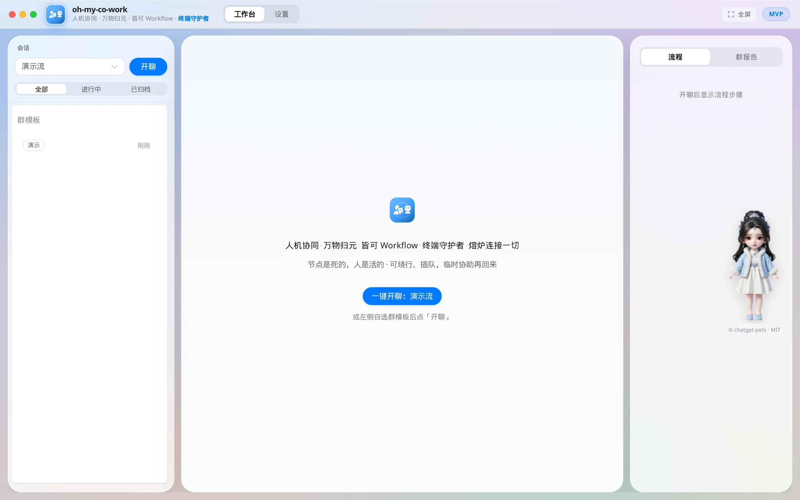
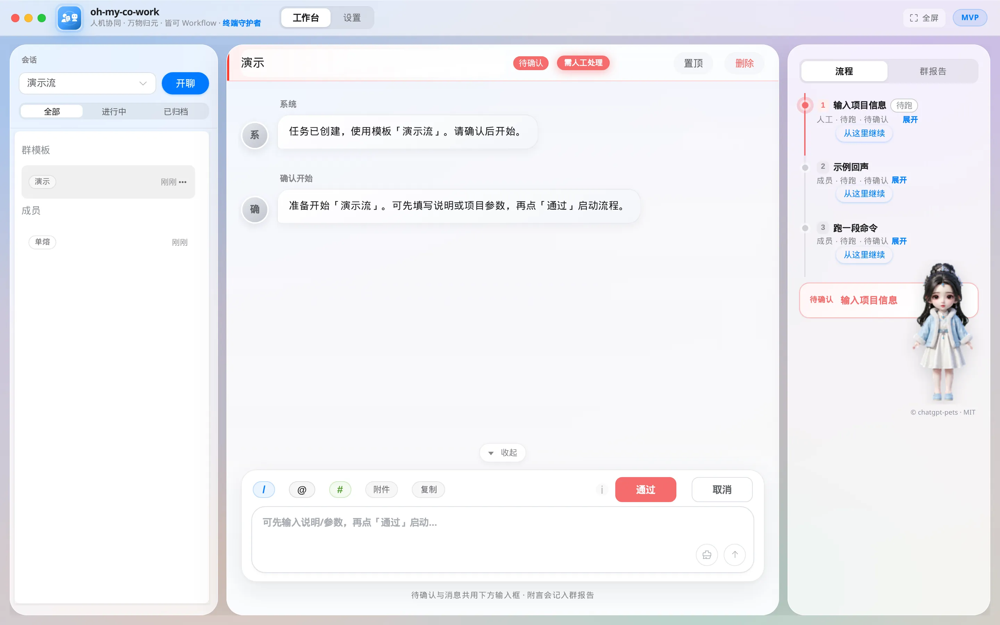
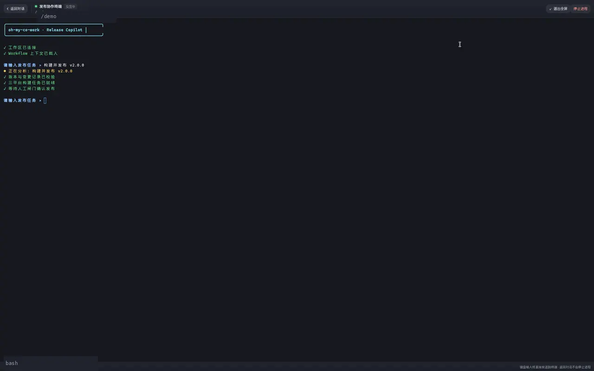
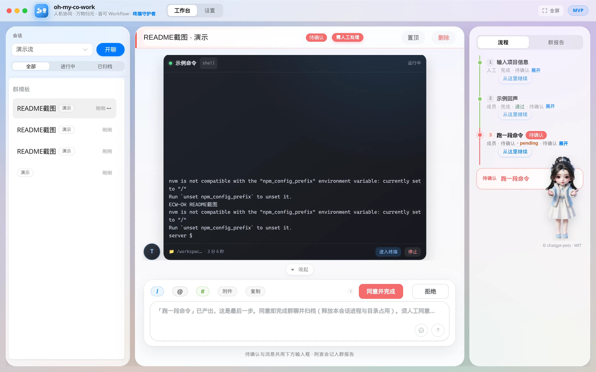
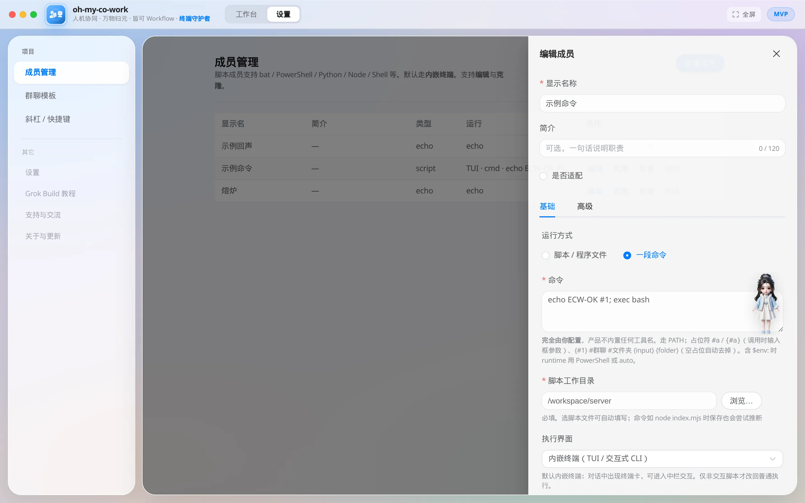
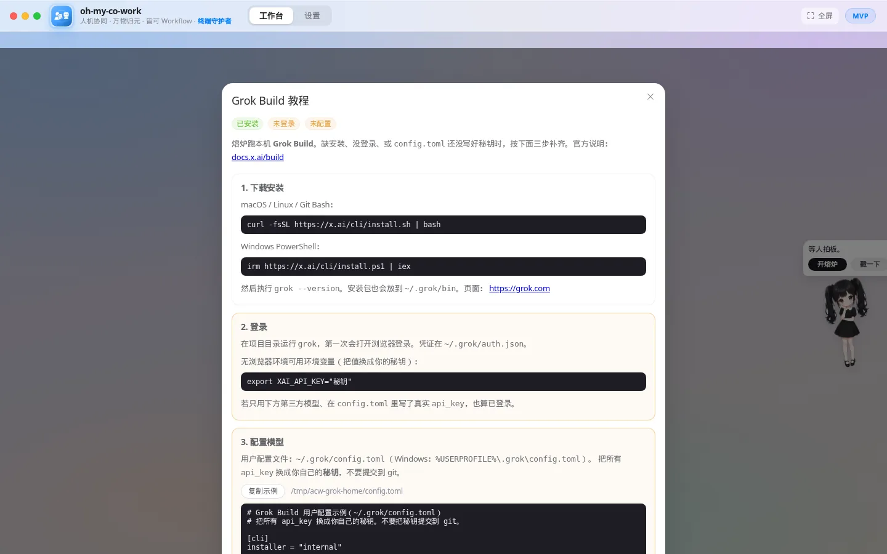
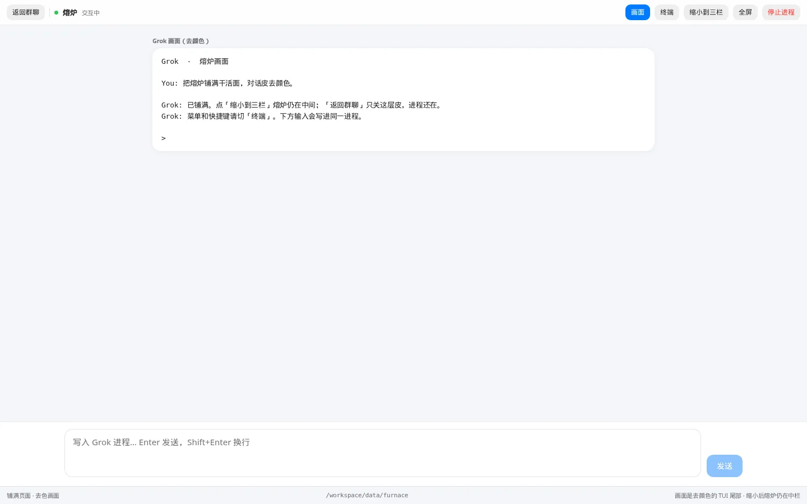
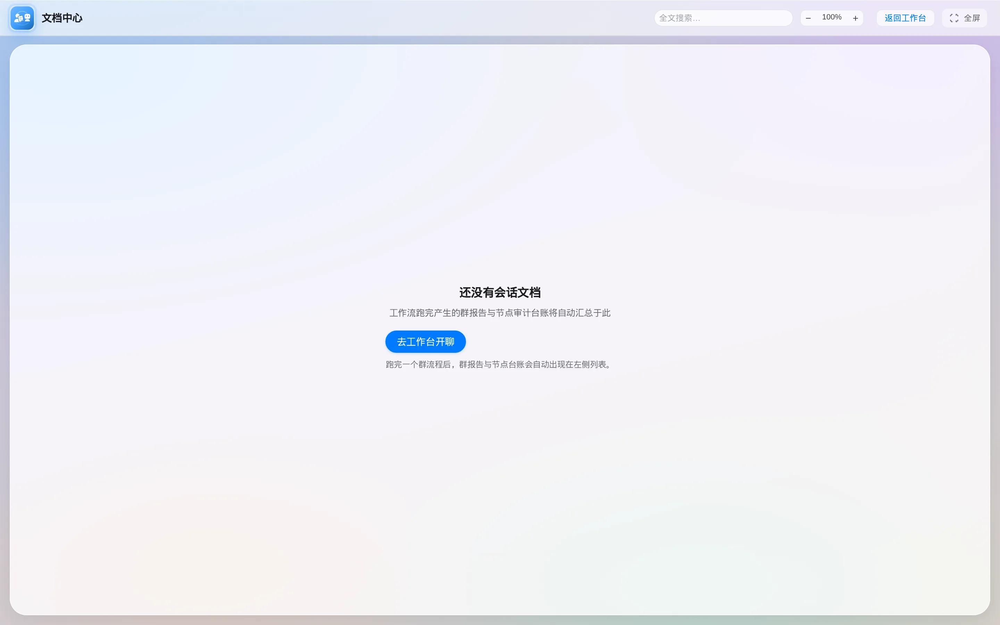
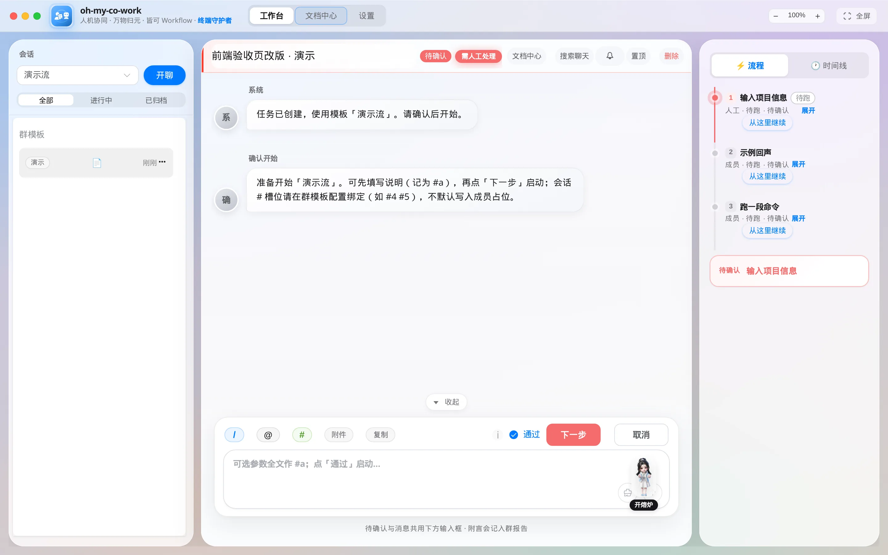
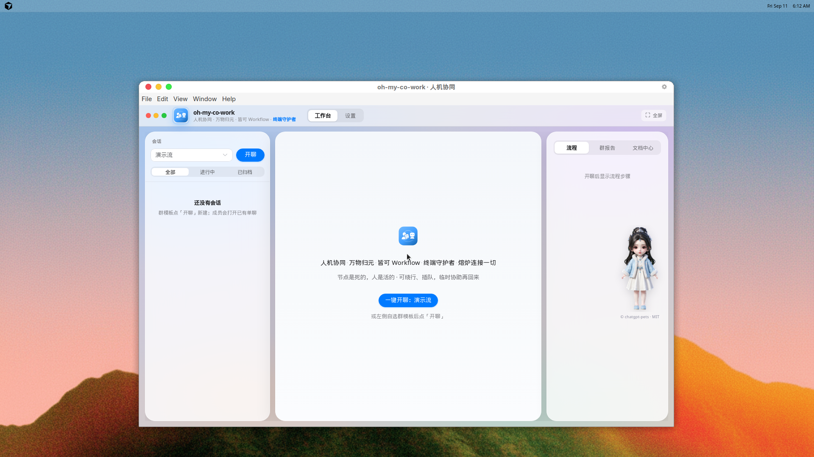

# oh-my-co-work

<p align="center">
  
</p>

<h3 align="center">人机协同 · 万物归元 · 皆可 Workflow · 终端守护者 · 熔炉连接一切</h3>

<p align="center">
  把人、Agent、脚本和 TUI 放进同一条 Workflow · 本地优先 · 人工闸门 · 内嵌真实终端
</p>

<p align="center">
  <a href="https://github.com/371684029/oh-my-co-work/stargazers"></a>
  
  
  = 18" />
  
  
</p>

> **节点是死的，人是活的。**
> Workflow 负责串起过程，人可以确认、拒绝、插队、绕行，也可以随时回来继续。

<p align="center">
  
</p>
<p align="center"><sub>桌宠立绘复制自 <a href="https://github.com/xiongxianzhu/chatgpt-pets">chatgpt-pets</a>（MIT © 2026 zhuxiongxian / 贡献者）：李慕婉 v2 图集，闲置呼吸、干活忙碌、等人询问；戳一下挥手，悬停会看向指针。</sub></p>


<p align="center"><sub>首页欢迎区 · 一键开聊演示流 · 右侧熔炉桌宠</sub></p>


<p align="center"><sub>三栏工作台：左会话、中对话与闸门、右流程轨</sub></p>

## 当前开发策略：Windows 桌面端优先（2026-10-27 起）

> **先保证项目最小可用。** 在 Windows 桌面端达到「下载即用」之前，以下规则优先于路线图与各版 plan：

- **冻结**：Web 端、Linux 桌面端、macOS 桌面端**不再新增功能**，只接受阻断性 bug 修复（崩溃、白屏、数据丢失）。
- **攻坚**：所有新开发集中在 **Windows 桌面端**（`oh-my-co-work.exe`）：安装 / 解压启动、服务端拉起、终端（node-pty）、SQLite、通知、托盘、退出与升级。
- **最小可用标准**：Windows 10/11 x64 上从 Release 下载 `-desktop.zip` → 解压 → 双击 exe → 工作台加载 → 新建会话并跑通一条 Workflow（含终端节点）→ 关闭后重开数据仍在。
- **CI 护栏**：每次提交都在真 Windows（`windows-latest`）上原生打包并双击级启动冒烟（5.7.0 PKG-14 已上线）；三平台打包与 linux 启动冒烟继续跑，只作回归护栏。
- 解冻条件：Windows 最小可用标准在实机全部通过。

## 为什么做它

很多自动化仍然散落在 BAT、PowerShell、CLI、TUI 和不同 Agent 里：执行在终端，决策在聊天，进度靠人脑记，出错后很难复盘。

| 痛点 | 现场长什么样 |
|------|----------------|
| 能力碎片化 | 脚本在终端，决策在聊天，进度在人脑 |
| 状态不可见 | 不知道卡在哪一步、谁在等谁 |
| 人机协同弱 | 要确认时只能停在黑框或 IM，没有「同意 / 拒绝 / 改参数」 |
| 串场难 | 不同执行体输出格式不一，上下文没法在步骤间复用 |
| 难复盘 | 一次任务的决策、消息、产物链断裂 |
| 终端跳出去 | 一进交互式 CLI，工作台就变成旁观者 |
| 文档七零八落 | 群报告、节点台账在会话目录里，要靠文件管理器翻 |

`oh-my-co-work` 把这些能力收进一个本地工作台：

- **像群聊一样协作**：一个工作流就是一个群聊，一个 Agent / 脚本就是一个成员。
- **关键决定交给人**：启动、参数、审核都可以设置人工闸门；群聊同意最后一步即完成并归档。
- **过程始终可见**：左边看会话，中间对话和执行，右边看流程与报告。
- **终端不再跳出去**：真实 PTY 内嵌 TUI。熔炉是本机官方 `grok` / `cursor-agent` CLI 的宿主（不是自研 Chat API）：默认铺满 **TUI**，可缩小回三栏。顶栏 **Grok CLI / Cursor CLI** 各走独立 PTY，切 Tab 不杀另一路。未装 Grok 或未登录时点桌宠弹出 Grok Build 教程。
- **数据留在本机**：SQLite、Markdown 台账、附件和日志全部保存在本地。
- **面向谁**：需要把多步脚本与 Agent 串起来、关键点必须人拍板的个人开发者和小团队。单机优先，不替代 Cursor / Grok 本体。
- **AI 放在哪一层**：**L3 流程嵌入**为主（群聊节点 + 人工闸门）；熔炉 Grok 提供 L2 代理；不做 L4 无人值守全自治。

对外案例口径（标题、标签、层级、提效、规划）见 [案例博客](./docs/product-ai-case-blog.md)。

## 使用场景

把日常流水线收成一条群聊：每一步是脚本、CLI、TUI 或 Agent 成员，关键处加人闸门。下面是几种常见配法，克隆群模板就能改。

**前端开发流**

切分支 → 起本地服务 → 脚本截 Figma / 对照稿 → 导出或拉取接口文档 → 氛围编程改页面 → 跑单测或 e2e → 提交并开/合 PR。本地服务和 TUI 走内嵌终端；合代码前用「同意」闸门。

**接口联调流**

拉最新 OpenAPI / 导出接口文档 → 起 mock 或连测试环境 → 跑集成脚本 → 人眼对一下响应 → 改客户端 → 提交。文档和命令都做成脚本成员，对不上就停在闸门。

**发版验收流**

切发布分支 → 跑测试与打包 → 预览包 / 打开产物 → 人验收截图或清单 → 打 tag、合并主干。打包用本机命令；「能不能发」留给最后一步人工同意。

**本机排障 + 熔炉**

复现命令进终端卡 → 需要改代码时点桌宠开熔炉（Grok 或 Cursor CLI）→ 人确认补丁 → 回归脚本 → 提交。熔炉和脚本同一条群聊里插队，不用另开窗口记进度。外部 Agent 可复制成员页「炼化 Skill」指令，把 diff 与结论写回文档中心。

## 2.0：真实 TUI，不是终端模拟



服务端使用 `node-pty`，前端使用 `xterm.js`。普通命令继续走原有 pipe 模式；交互式 CLI 可选择内嵌终端：

- 对话中出现实时终端卡，保留任务时序。
- 点击进入中栏终端工作区，右侧流程仍然可见。
- 支持键盘输入、窗口缩放、重新附着、停止进程与日志。
- 工作台和终端都可以独立全屏；终端另有 **满屏**，铺满页面、不调用系统全屏。
- 群聊走完默认归档并释放本会话进程；成员单聊不自动归档。其它占用可在设置里手动释放。
- **2.0.1**：本机 REST/WebSocket 使用随机访问令牌与回环 Origin 校验；停止、PID、长输出与断线重连已加固。

<table>
  <tr>
    <td width="50%">
      
      <p align="center"><b>对话、闸门与流程同屏</b></p>
    </td>
    <td width="50%">
      
      <p align="center"><b>脚本成员按需启用 TUI</b></p>
    </td>
  </tr>
</table>

## 3.7：熔炉干活面（3.x 封板）

点右侧桌宠「开熔炉」（或点两下头像）。本机已装且已登录 Grok 时直接铺满干活面；否则弹出 **Grok Build 教程**。

熔炉 **没有** 自研一套 Grok HTTP 客户端：工作台用 node-pty 托管本机官方 `grok` CLI。原理见 [熔炉 Grok 客户端](./docs/tech-crucible-grok-client.md)。





- 桌宠用 [chatgpt-pets](https://github.com/xiongxianzhu/chatgpt-pets) **v2 图集**（李慕婉）：闲置 `idle` / 干活 `running` / 等人 `waiting`；戳一下播 `waving`；悬停看向指针。系统要求减少动效时停在 idle 第一帧。立绘从该 git 复制，**MIT © 2026 zhuxiongxian / chatgpt-pets 贡献者**（见 `web/src/assets/pets/LICENSE`）。
- 3.7 当时默认 **GUI**（欢迎卡 + 可读正文）。**4.8 起**产品默认铺满 **TUI**，GUI 入口已隐藏。附件仍可落到熔炉 `inbox/`，发送时把相对路径写成一行写进同一进程。
- 开炉写入 `data/furnace/AGENTS.md` 短规则 + `.grok/rules/session.md`（官方 CLI 没有能给交互式会话预填第一句话的参数，短启动词跟着规则一起写进去，由 grok 自己按目录发现）。长文在 `ACTIVE.md`，禁止复述。不写 `~/.grok/AGENTS.md`。
- **TUI**：原 Grok / Cursor 终端。菜单和快捷键走这里。隐藏时不把 PTY 缩成几列。首次进入后切皮不拆终端。
- **双 Agent**：顶栏切换 Grok CLI 与 Cursor CLI；熔炉聚焦时 `Ctrl/Cmd+1`、`Ctrl/Cmd+2` 有效。Cursor 命令默认为 `cursor-agent`（设置可改）。未安装时不会假装已登录。
- **缩小到三栏**：熔炉仍在中栏；**返回群聊**只关这层皮，进程还在。
- 设置「开熔炉默认」铺满 TUI（GUI 入口已隐藏）。Grok / Cursor CLI 顶栏 Tab 切换，互不杀进程。熔炉默认能做用户交代的任何事，系统审核与闸门更专业。

## 4.x：协同文档中心

群报告、会话索引和节点台账都在 `data/journals/` 里。文档中心把它们聚成一个可搜、可编、可导出的页面，不用翻文件夹。


<p align="center"><sub>独立页面 <code>/docs</code>：左侧树形浏览（群模板 › 会话 › 文档）· 顶栏全文搜索 · 公告可编辑 · 按群 / 全部导出 zip</sub></p>


<p align="center"><sub>工作台不再内嵌文档预览；点会话顶栏「文档中心」跳转独立页（带当前会话上下文）</sub></p>

- 双栏：左栏资源管理器（按群模板树或按时间列表）+ 右栏 Markdown 渲染；侧栏底部 **节点炼化与还原** 查看成员炼化/适配备份与工作流节点改动。
- 工作台顶栏「文档中心」打开同一套文档页；右侧流程轨只保留流程与时间线。
- 只有 `ANNOUNCEMENT.md` 可编辑；节点台账只读，避免改坏溯源。
- 第三方 Agent 可用 `POST /api/docs/refine`（或成员页复制的 `agent-refine-skill` 指令）把输入 / diff / 结论追加进群报告。
- 网页链接新标签打开；文档互链页内跳转；本地路径只开所在文件夹（不直接执行文件）。
- 导出走群模板 zip；全文搜索在文档中心顶栏。

## 已实现

| 能力 | 说明 |
|------|------|
| 群聊式工作流 | 群模板、成员、会话、线性节点与实时状态 |
| 人工闸门 | 启动确认、参数输入、同意/拒绝；最后一步为「同意并完成」 |
| 熔炉 | 右侧桌宠；干活面默认 **TUI**；顶栏 **Grok CLI / Cursor CLI** 独立 PTY；**返回群聊只关皮**；顶栏「进程」里**关闭熔炉 / 新开熔炉**才清当前 Agent 对话；短 AGENTS + rules 文件 |
| 界面缩放 | 顶栏 `− 100% +` 控件缩放整个界面（60%～160%，记住设置） |
| 内嵌 TUI | PTY + xterm，支持输入、ANSI、resize、回放、停止、主题、粘贴确认（非阻塞，粘贴后可继续输入）、满屏与全屏；**5.3.2** 起输出按帧合并写入、隐藏 Tab 暂停绘制，减轻熔炉/Cursor CLI 长输出卡顿与黑屏；滚动缓冲跟随设置 |
| 流程轨 | 当前节点、历史、克隆、跳过步骤折叠、从节点继续；适配角标 |
| 场外协助 | `@成员` 临时插队，完成后回到主流程；折叠态直接标出实际用了哪个成员 |
| 快捷输入 | `/` 指令、`@` 协助、`#` 会话参数与节点输出 |
| 群报告 | 自动汇总参数、节点输入输出和人工备注，落地 Markdown；在文档中心阅读与编辑 |
| 文档中心 | 阅读样式参考飞书文档（正文大、标签小）；独立顶栏 + 左侧 VS Code 式资源管理器；工作台顶栏一键进入；公告可编辑、全文搜索与按群导出 zip |
| 炼化 | 成员勾选后**保存当下**改源（`ACW-REFINE`）并 **pipe 试跑验证**（`verifyLast` / 抽屉「试跑验证」）；`acw-ctl verify-member`；适配 plan 预览；还原中心 diff/还原；开聊闸门 **下一步**（回车带参） |
| 更新与备份 | 启动检查更新默认开（设置可关，只读版本号、不自动安装）；设置页提供**一键导入与一键导出**（导入备份包恢复数据，恢复前自动留快照可回退；导出为全量协同文档 ZIP）；备份/还原生产热路径全异步（integrity/checkpoint 走 worker）；关于页状态无缝联动 |
| 会话治理 | 置顶、改名、删除（顶栏删除会从列表拿掉并清终端行）、续跑；群聊完成即归档；设置里释放资源、备份、配额与脱敏 |
| 系统通知 | 分级（需要你/出错了/完成了）、点击深链直达会话/闸门；收件箱落库可回看；托盘待办菜单与暂停通知；Windows 任务栏角标/Dock 徽章；勿扰时段与前台抑制 |
| 模板复用 | `.acw.json` 导出/导入，路径占位 `{{WORKSPACE}}`/`{{HOME}}`；冲突支持改名/跳过/**覆盖**（id 不变原地更新） |
| JSONL Adapter | 可信侧通道提问转闸门、工具卡与结果写回；失败降级为真实终端 |
| 本地数据 | SQLite + Markdown + 本地附件和日志 |

## 快速开始

### 桌面窗口（推荐）

下载 [latest release](https://github.com/371684029/oh-my-co-work/releases/tag/latest) 里对应平台的 **`oh-my-co-work-v5-<平台>-desktop.zip`**（`win32-x64` / `linux-x64` / `darwin-arm64`；内含 Electron 窗口和 Node 运行时，一般不用再装 Node.js）。Linux / macOS 解压后运行 `./start.sh`；macOS 为未签名便携版，被 Gatekeeper 拦截时在解压目录执行 `xattr -dr com.apple.quarantine .`。

**Windows**：解压后双击 `start.bat`（或 `desktop/oh-my-co-work.exe` 同目录下的启动脚本），应立刻出现全屏窗口（先显示 Logo 与「正在启动本机服务」，再进入工作台）。托盘与 exe 图标与首页 Logo 一致。关窗会藏到托盘；要停服务请用托盘菜单 **退出**。

请用 **`*-win32-x64-desktop.zip`**（不要用轻量 `*-win32-x64.zip`）。解压到新文件夹再打开。若黑窗停住并提示失败，把解压目录里的 `data/electron.log`、`data/desktop-launch.log` 发出来。


<p align="center"><sub>4.9.1 桌面包：Logo 图标 exe、默认全屏打开工作台并拉起本机服务</sub></p>

源码开发也可以：`npm install` 后执行 `npm run dev:desktop`（需本机已能访问工作台 API，或让 Electron 自行拉起 `server`）。

### 轻量运行包（浏览器）

在 [latest release](https://github.com/371684029/oh-my-co-work/releases/tag/latest) 下载对应平台压缩包（**需本机 Node.js ≥ 18**，打开系统浏览器）：

```text
Windows  → 解压后双击 start.bat
macOS    → 解压后运行 ./start.sh
Linux    → 解压后运行 ./start.sh
```

运行包已包含依赖，通常不需要再次执行 `npm install`。当前源码版本 **5.9.0**（炼化·适配·验证闭环、闸门「通过+下一步」、`paramBindSlots`、文档中心 **运行验证记录** → 时间线「验证」筛选）。

| 产物 | 路径（本地打包，不进 git） |
|------|---------------------------|
| Linux 轻量包 | `packages/oh-my-co-work-v5-linux-x64.zip`（`npm run pack`） |
| Windows 桌面包 | `release/oh-my-co-work-v5-win32-x64-desktop.zip`（`ACW_PACK_TARGET=win32-x64 npm run pack:desktop`） |

桌面窗口请用 **`*-desktop.zip`**。`packages/` 仅放可入仓的轻量 zip；超过 100MB 的桌面包在 `release/`。桌宠图集打在前端里：要看 **chatgpt-pets 李慕婉**，请重新下载 zip 解压覆盖，不要沿用旧文件夹。发布前建议：`npm run lint`、`npm test`、`npm run test:web`、`node scripts/selftest-refine-adapt.mjs`；包内 `BUILD_INFO.json` 可用于排障。

### 从源码启动

```bash
git clone https://github.com/371684029/oh-my-co-work.git
cd oh-my-co-work
npm install

# 终端 1：API / Workflow 引擎
npm run dev:server

# 终端 2：Vue 工作台
npm run dev:web
```

也可以一键启动（检查依赖、构建前端、起服务并打开浏览器）：

```bash
node start.mjs
# Windows 也可双击 start.bat；macOS / Linux：./start.sh
```

打开 <http://127.0.0.1:5173>，选择内置的「演示流」并点击开聊。工作台会通过 `/api/bootstrap` 领取本机令牌；`/api/health` 无需令牌，其余 `/api` 与 WebSocket 需要令牌。请用 `127.0.0.1`，少用 `localhost`。

脚本成员默认使用内嵌终端。仅非交互脚本才在设置里改回「普通执行」。

### 配置一个内嵌 TUI 成员

在 **设置 → 成员管理** 中选择“内嵌终端”，或直接使用以下配置：

```json
{
  "kind": "script",
  "script": {
    "mode": "command",
    "command": "your-cli",
    "scriptWorkDir": "/your/workspace",
    "executionMode": "terminal"
  }
}
```

未设置 `executionMode` 时默认内嵌终端；只有显式选择普通执行才会走原来的 pipe。

## 技术栈

```text
Vue 3 + Element Plus + Element-Plus-X
                  │ WebSocket
Node.js + Express + Workflow Engine
                  │
        node-pty / ConPTY / PTY
                  │
      BAT · PowerShell · CLI · TUI

SQLite ── 调度真相
Markdown ── 可读台账
Local Files ── 附件与日志
```

这是一个 npm workspaces 项目：

```text
web/       Vue 工作台与 xterm 终端
server/    API、Workflow 引擎、PTY 与进程治理
shared/    状态、参数和格式化约定
docs/      产品、架构、存储与实施文档
packages/  本地 npm run pack 输出（gitignore；正式下载见 Release）
```

## 文档

文档按类别前缀命名（`plan-` 版本类 · `tech-` 技术类 · `spec-` 规范类 · `guide-` 指南类 · `product-` 产品类），规范详见 [docs/README.md](./docs/README.md)。

**产品（product-）**

| 文档 | 内容 |
|------|------|
| [案例博客](./docs/product-ai-case-blog.md) | 对外案例单一事实源：痛点、场景、AI 层级、提效与规划（对齐 4.2.0） |
| [产品宗旨与验收](./docs/product-mvp.md) | MVP 做没做、验什么；各版本封板记录 |
| [Logo 与品牌资产](./docs/product-brand-logo.md) | Logo 含义（左人 · 中文档 · 右机）与资产清单 |

**指南（guide-）**

| 文档 | 内容 |
|------|------|
| [演示指南](./docs/guide-demo.md) | 从启动到跑通演示流 |
| [脚本接入指南](./docs/guide-script.md) | BAT / PowerShell / CLI、参数、cwd 与终端模式 |
| [压缩包用户说明](./docs/guide-release-user.md) | 一键启动、平台要求与故障排查 |

**技术（tech-）**

| 文档 | 内容 |
|------|------|
| [技术设计](./docs/tech-design.md) | Workflow、会话、节点、闸门与扩展设计 |
| [数据存储](./docs/tech-data-storage.md) | SQLite、Markdown、附件、日志与备份 |
| [数据与工程清单](./docs/tech-data-and-ops.md) | 数据分层原则、稳定与扩展 P0–P4、待改进 backlog |
| [2.x TUI 设计](./docs/tech-tui-2x.md) | 产品形态、PTY 架构、协议、安全与平台兼容 |
| [3.x 熔炉设计](./docs/tech-crucible-3x.md) | Grok Agent + 提示词适配；加人改代码 / 加适配节点；桌面亦名熔炉 |
| [3.5 熔炉 GUI / TUI](./docs/tech-crucible-3.5.md) | 铺满干活面、缩小回三栏、GUI 与 TUI 同一进程 |
| [3.7 熔炉封板](./docs/tech-crucible-3.7.md) | 3.x 最终封板：chatgpt-pets 桌宠图集、头像、GUI 附件、PTY 宿主 |
| [熔炉 GUI 可读正文](./docs/tech-crucible-gui-plain.md) | GUI 去 TUI 框线/底栏，只留能读的字 |
| [熔炉 Grok 客户端原理](./docs/tech-crucible-grok-client.md) | 不调 Chat API；PTY 里跑官方 grok CLI |

**规范（spec-）**

| 文档 | 内容 |
|------|------|
| [自测体系](./docs/spec-selftest.md) | 测什么、怎么跑、表征测试/依赖注入/轮询等待三套路、发布闸门 |
| [实机检查清单](./docs/spec-qa-checklist.md) | 三平台复制/粘贴/IME/缩放/通知勾选（5.2.0 TEST-07） |
| [通知实机检查清单](./docs/spec-qa-notification.md) | 三平台通知权限、深链、托盘角标、勿扰（5.4.0 NTF-T3） |
| [前端组件与 UI 约定](./docs/spec-frontend-components.md) | 优先 Element-Plus-X + UI 布局/氛围约定 |
| [目录与模块边界](./docs/spec-directory-structure.md) | 仓库目录约定（对齐代码） |

**版本计划（plan-）**

| 文档 | 内容 |
|------|------|
| [2.x 实施计划](./docs/plan-tui-2x.md) | 2.0～2.3 阶段、测试、风险与完成定义 |
| [3.x 熔炉计划](./docs/plan-crucible-3x.md) | 3.0～3.7 阶段与完成定义 |
| [3.8 重构与加固计划](./docs/plan-refactor-3.8.md) | 引擎拆分、工作台拆分、ESLint 与令牌收紧（已实施） |
| [4.x 协同文档中心计划](./docs/plan-docs-4x.md) | 聚合群报告/节点台账，左菜单右渲染，公告可编辑，链接可点（4.0.0）；检索导出（4.1.0）；更新检查与备份恢复（4.2.0） |
| [4.5/4.6 炼化与搜索计划](./docs/plan-refine-search-4x.md) | 熔炉炼化与全局模糊搜索实施计划（已实施核心） |
| [4.7～5.x 总纲](./docs/plan-4.7.0.md) | 早期演进大纲（4.8/4.9 细节见下两份） |
| [4.8.0 双引擎 TUI](./docs/plan-4.8.0.md) | Cursor CLI + 熔炉、默认 TUI、桌面全屏；文内落地跟踪 |
| [4.9.0 文档中心与桌面图标](./docs/plan-4.9.0.md) | Logo 托盘/exe、炼化 Skill、群报告并入文档中心；文内落地跟踪 |
| [5.0.0 性能与交互优化](./docs/plan-5.0.0.md) | 内置 CLI / 熔炉精灵优化、性能基线、交互统一 |
| [5.1.0 全量优化台账](./docs/plan-5.1.0.md) | CLI / 桌面壳 / 安全 / 发布；与 5.0 验收对齐 |
| [5.2.0 全方位优化](./docs/plan-5.2.0.md) | 熔炉 CLI 复制粘贴、炼化还原、文档中心入口 |
| [5.3.0 可追溯与扩展](./docs/plan-5.3.0.md) | 步骤快照/回退、模板导入导出、命令面板、Agent 注册表 |
| [5.4.0 系统通知](./docs/plan-5.4.0.md) | 桌面通知分级、深链、托盘角标、任务栏/Dock |
| [5.5.0 收尾 5.x 未完成项](./docs/plan-5.5.0.md) | 备份全异步、全站 E2E、设置页 i18n/aria、前端按需分块、三平台桌面包、`useSessionDetail` 拆分；剩实机通知 QA（NTF-T3/T4） |
| [5.6.0 需求文档](./docs/plan-5.6.0.md) | 5.x 收尾加固与三平台桌面补全：P0/P1/P2 需求清单、非功能需求与版本 DoD；代码侧 P0 已收尾 |
| [5.7.0 需求文档](./docs/plan-5.7.0.md) | 打包链路一劳永逸与发布治理：纯 Node 压缩、Windows 原生打包+启动冒烟、发布重试、配置迁出安装目录、产物出 git、备份导入/导出统一 ZIP；剩运行时升级与签名 |
| [5.8.0 熔炉/CLI 性能 II](./docs/plan-5.8.0.md) | 5.3.2 已落地项台账与后续增量 parse / 性能 HUD |

## 路线图

- [x] 1.x：群聊工作台、流程引擎、闸门、归档与续跑
- [x] 2.0：真实 PTY、终端卡、中栏 TUI 工作区与全屏
- [x] 2.0.1：本机令牌与 Origin 防护、PID/长输出/重连修复
- [x] 2.2：常驻交互终端、start.bat 修复、终端卡与闸门打磨
- [x] 2.2.1：内嵌终端默认常驻、非 Windows 运行时自动、bootstrap 要 Origin
- [x] 2.3.0 最终封板：设置释放资源、去掉超时/归档闸门、终端守护者
- [x] 2.4.0 最终封板：终端偏好、配额、日志脱敏、重连缺口提示、JSONL Adapter 提问转闸门
- [x] 2.5.0 最终封板：首页「皆可 Workflow」后加重标识终端守护者
- [x] 2.6.0 最终封板：终端满屏（铺满 HTML 页面）与全屏并存
- [x] 3.3.0：熔炉桌宠、适配、工作流 prompt、Grok Build 教程；群聊完成即归档
- [x] 3.5.0：熔炉铺满 GUI（可缩小回三栏、可切 TUI）
- [x] 3.7.0 最终封板：chatgpt-pets 桌宠图集（李慕婉）、干活面头像、GUI 可读正文与短合同开炉、GUI 附件（路径写入 PTY）、Grok 原理文档
- [x] 3.7.1：熔炉桌宠/头像裁切修复、修复 Windows 内嵌终端「File not found」启动失败、收回适配筛选 Tab、三平台生产包发布流水线加固（打包即验 + CI 成本收紧）
- [x] 3.7.2：修复熔炉启动报错 `unexpected argument '--prompt'`——官方 grok CLI 没有 --prompt 参数，短启动词改经 AGENTS.md/rules 文件传，不再走命令行
- [x] 3.7.3：临时协助节点折叠状态直接标出实际 @ 的成员，不用展开就知道用了哪个工具
- [x] 3.7.4：支持与交流补邮箱联系方式（371684029@qq.com）
- [x] 3.8.0：引擎拆分——engine.js 模块化（store/offsite/archive/adapterEvents/advance/sessionLifecycle/gates/mentions/userInput，单向依赖无环），gate 与 advance 补 14 个直接单测
- [x] 3.8.1：工作台拆分——Workbench.vue 799 行布局壳、三栏组件化（SessionRail/FlowRail/ComposerPanel）、终端状态收敛进 composables、复制逻辑单一来源（terminalStatus/pagefill/localUploads）
- [x] 3.8.2：工程加固——ESLint 进 CI（0 error）、REST 收紧 `?token=`（WS 例外）、web 纯逻辑测试 13 例；浏览器人工冒烟与三平台打包交由后续流水线补验
- [x] 4.0.0：协同文档中心——本地聚合群报告/节点台账，新标签打开独立页面（左菜单右内容），默认群模板排序可切时间排序，群公告 MD 可编辑，超链/文档互链/本地文件夹链接可点
- [x] 4.1.0：文档中心增强——全文搜索、节点文档徽标、打包本群全部 MD 导出
- [x] 4.2.0：发布更新与本地历史保留——启动检查更新（默认开、设置可关；只读版本号、不自动安装）、更新面板、更新前一键备份、备份恢复、schema 迁移链；更新动作永不触碰数据目录
- [x] 4.2.1：文档中心解耦与工作台三栏集成（内嵌台账预览与群导出）、设置页新增一键备份（本地快照+下载）与一键导出（全量文档 ZIP）、熔炉通栏满屏与元信息胶囊卡片美化（深度思考与耗时结构化呈现）、下载安全与竞态加固
- [x] 4.5.0：熔炉炼化——成员/步骤炼化字段、执行后格式化进台账（stdout 优先）、规格回写不覆盖其它 config；**保存当下按契约改源文件**
- [x] 4.6.0：四维模糊搜索 + 审查修复——拼音阈值与打分排序、文档中心竞态、备份恢复拒绝符号链接、活库损坏可恢复、协议相对链接外链处理
- [x] 4.7.0：Windows 桌面窗口包——`*-win32-x64-desktop.zip` 双击 start.bat 打开 Electron 工作台并拉起服务（包内 Node+Electron，关窗藏托盘）；轻量 zip 仍进 `packages/`
- [x] 4.8.0：群聊第三栏 Cursor CLI / 熔炉双 Tab、独立 PTY；熔炉默认 TUI；桌面启动全屏；熔炉默认通用 Agent（审核/闸门更专业）
- [x] 4.9.0：托盘与 `oh-my-co-work.exe` 用首页 Logo；第三栏只留文档中心；炼化 Skill 可复制；设置抽屉不被桌宠挡住
- [x] 4.9.1：顶栏缩放；一键备份改为一键导入；文档中心飞书风阅读样式；熔炉精灵缩小约 1/3 且设置页可见；修复终端粘贴后无法输入
- [x] 5.0.0：性能优化 / 交互优化，重点内置 CLI 与熔炉精灵，见 [docs/plan-5.0.0.md](./docs/plan-5.0.0.md)
- [x] 5.1.0：全量优化台账——CLI / 桌面壳 / 安全 / 发布，多数已合入，残留 bracket 见 [docs/plan-5.1.0.md](./docs/plan-5.1.0.md)
- [x] 5.2.0：终端复制粘贴 / 炼化还原 / 文档中心入口 / 通知基础层，见 [docs/plan-5.2.0.md](./docs/plan-5.2.0.md)
- [x] 5.3.0：可追溯与扩展——步骤快照/diff、一键回退、时间线、模板导入导出（含覆盖导入）、命令面板、Agent 注册表、大文件拆分，见 [docs/plan-5.3.0.md](./docs/plan-5.3.0.md)
- [x] 5.3.1：熔炉卡死修复——节点快照/步骤回退 git 全异步（旧 execFileSync 每节点最多 6 次同步 git 卡事件循环）、Windows taskkill 非阻塞、PTY spawn 命令缓存、终端回放缓冲与通知 Map 防泄漏
- [x] 5.3.2：熔炉与内置 CLI 性能 II——xterm 按帧合并写入、大块 replay 分片灌入、WebGL 黑屏兜底、WS 输出不再每包刷新 Vue replay、熔炉 GUI 解析节流、单 xterm 切换 Agent、attach 回放 tail 512KB，见 [docs/plan-5.8.0.md](./docs/plan-5.8.0.md)
- [x] **5.9.0**：炼化 verifyPreview、试跑矩阵、炼化验证演示种子；闸门「通过+下一步」、`paramBindSlots`；适配回落 toast；见 [docs/plan-5.9.0.md](./docs/plan-5.9.0.md)
- [x] 5.4.0：完整桌面系统通知——分级、深链、托盘角标、任务栏/Dock、三平台适配，实机 QA（NTF-T3/T4）待勾，见 [docs/plan-5.4.0.md](./docs/plan-5.4.0.md)
- [ ] 5.5.0（进行中）：收尾 5.x——备份/还原生产热路径已全异步（worker 级 integrity/checkpoint）、全站 E2E、设置页 i18n/aria、Element Plus 按需分块、FlowRail/FurnaceWorkspace 拆分、三平台桌面包（macOS/Linux Electron）、`useSessionDetail` 拆分（614→295 行）均已落地；剩实机通知 QA（NTF-T3/T4），见 [docs/plan-5.5.0.md](./docs/plan-5.5.0.md)
- [ ] 5.6.0：5.x 收尾加固与三平台桌面补全——`useSessionDetail` 拆分收尾、Workbench 无障碍、macOS/Linux 打包签名、选中即复制、文档 DOMPurify 净化均已落地；剩通知实机验收（NTF-T3/T4）与 P1/P2 残留项，见 [docs/plan-5.6.0.md](./docs/plan-5.6.0.md)
- [ ] 5.7.0：打包链路一劳永逸——PKG-01~10、14~16 已落地（纯 Node zip/tar 去系统工具依赖、Windows runner 原生打包+真机启动冒烟、Release 缺 win32 包即阻断+上传 5 次重试、产物只发 Release、配置迁至数据目录、备份导入/导出统一 ZIP、熔炉预置 acw-ctl.mjs 管理 CLI、文档中心新增「节点炼化与还原」（源码 diff 与一键还原）、桌面窗口不盖任务栏、熔炉 Grok/Cursor 切换保活不截断且等宽字体/WebGL 图集对齐不乱码、首屏 JS -16%）；**当前 Web / Linux / macOS 功能冻结，全力攻坚 Windows 桌面端最小可用**（见上文「当前开发策略」）；剩 Node/Electron 运行时升级、Windows 签名与历史大文件清理，见 [docs/plan-5.7.0.md](./docs/plan-5.7.0.md)
- [ ] 后续：无边框/vibrancy、多终端标签治理、更多 CLI Adapter

## 参与项目

欢迎提交 [Issue](https://github.com/371684029/oh-my-co-work/issues) 或 Pull Request：

1. 先描述使用场景和希望解决的问题。
2. 行为变化同步更新文档。
3. 新执行体优先保持可插拔，不把具体工具写死在 Workflow 内核。

技术交流也可到工作台 **设置 → 支持与交流**，邮箱 `371684029@qq.com`。

如果这个项目让你的脚本、Agent 或 TUI 更容易协作，欢迎点一个 **Star**。
它会帮助更多正在解决同类问题的人看到这个项目。

## 点赞支持

完全自愿，不影响任何功能。若你愿意，期待一点点小惊喜 ✨

| 微信 | 微信 | 支付宝 | 添加好友 |
|:---:|:---:|:---:|:---:|
|  |  |  |  |
