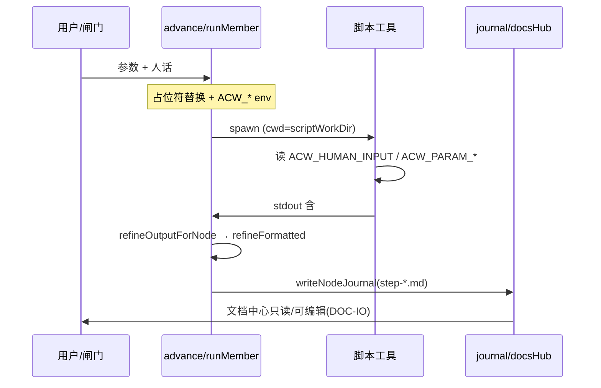

# 6.3.0 计划：熔炉炼化 · 协同台与脚本工具输入输出对接

> **定位**：6.2.0 已收口「只有一个熔炉炼化开关、去掉是否适配」；6.3.0 把**契约说清楚、体验收拢**：协同台如何把本轮输入交给脚本、如何把稳定产出写进文档中心，以及「炼化」怎样改造工具源文件使之遵循同一规范。本版以**文档 + 少量产品/工程补齐**为主，避免再开第二条「对接模式」。
>
> **产品一句话**：熔炉炼化 = **协同台注入输入（环境变量 / 占位符 / 可选 stdin）** + **脚本按约定产出（stdout `###` 标题或炼化后正文）** → **节点台账 `step-*.md` / 群报告**；不对用户暴露 adapt/JSONL 等并行叙事（JSONL 仅作终端进阶选项）。
>
> **约束**：本机优先；契约以 `guide-script.md` 与 `ACW-REFINE` 标记为单一事实源；改造脚本须先 `data/backups/refine` 备份；人工修正产出走 6.2 **DOC-IO**（文档中心编辑台账），不默认回改脚本。

---

## 一、协同台 ↔ 工具：输入输出对接模型

### 1.1 输入（协同台 → 脚本）

| 通道 | 谁写入 | 脚本如何读 | 典型场景 |
| --- | --- | --- | --- |
| **占位符替换** | `runMember` 启动前 | `command` / `args` / `env` 里的 `#1`、`{#a}`、`{folder}` 已替换为字面值 | 命令行一眼可见参数 |
| **环境变量** | `runMember` 组装 `env` | `ACW_HUMAN_INPUT`、`ACW_PARAM_1`…`ACW_PARAM_n`、`ACW_PARAMS_JSON`、`ACW_SESSION_ID`、`ACW_CWD`… | 炼化契约、多语言脚本统一读 env |
| **stdin** | 可选 `useHumanAsStdin` / 终端 | PTY 管道写入人话 | 交互式 CLI |
| **JSONL 事件**（可选） | 脚本写 `.acw-adapter.events.jsonl` | 引擎 `adapterEvents` 读文件，**不解析终端画面** | 长驻 TUI / 熔炉 Agent；**不是**炼化开关 |

人话与项目参数来源：群模板采集的 `#1`…`#n`、闸门补参、聊天框 `@`/`#` 提交 → 会话 `context.params` + `lastHumanInput` → 节点执行时并入 `paramsMap` 与 `humanInput`。

### 1.2 输出（脚本 → 协同台 → 文档）

| 阶段 | 形态 | 落点 |
| --- | --- | --- |
| **运行结束** | `result`（stdout/stderr、退出码、终端日志路径） | SQLite `node_instances.output_json` |
| **炼化格式化** | `refineOutputForNode` → `refineFormatted` 字符串（常含 `### 标题`） | 写入节点 `input_json` 并参与台账 |
| **台账** | `writeNodeJournal`：`## 输入` / `## 输出`；输出优先 `refineFormatted` | `data/journals/sessions/<id>/nodes/step-*.md` |
| **文档中心** | 扫描 journals 白名单 | 侧栏导航、`ANNOUNCEMENT.md` 群报告 |

用户心智：**工具 stdout（或炼化后的正文）= 文档中心里的「输出」块**；不准时可在文档中心 hand-edit（6.2 DOC-IO，待做）。

### 1.3 端到端（pipe 成员 · 已炼化）

---

## 二、熔炉炼化如何改造工具（契约层）

### 2.1 保存时改源（`applyRefineOnMemberSave`）

触发：设置里勾选「熔炉炼化」并**保存成员**（`persistRefineOnSave` → `refineSource.js`）。

1. **备份**：`createAdaptBackup`（目录名 `data/backups/refine`，`kind: refine`）。
2. **插入契约块**（幂等标记 `ACW-REFINE`）到可注释脚本首部：`.bat/.cmd/.ps1/.sh/.py/.js/.mjs/…`
   - 从 env 回填 `ACW_PARAM_1` / `ACW_HUMAN_INPUT`（空则回退 `%1` / `argv`）。
   - 在 stdout **最先**打印 `### <标题>`（标题来自 `produceRefineSpec` / 成员名兜底）。
   - Node 追加 `acwSyncArgvFromEnv`：命令里只写部分 `#n` 时，仍同步 `ACW_PARAM_1…n` → `process.argv[2…]`。
3. **写规格**：`config.refine.format`（含 `title`、`input.env`、`output.channel: stdout`）与 `refineBackup` / manifest 路径。
4. **试跑**（可选）：`verifyMemberSync` — pipe 探针、`ACW_HUMAN_INPUT=acw-verify-probe`，检查 stdout 是否含 `###` 标题 → `verifyLast` / `verifyFailed`。

**不推荐炼化**：`.bat` 仅作包装、无业务逻辑时，应炼化真实入口 `node index.mjs`（成员设置与 `guide-script.md` 已写明）。

### 2.2 运行时注入（与契约配套）

即使源文件已炼化，**每次执行**仍由 `runMember.js` 注入全套 `ACW_*`（与占位符替换并行）。脚本契约块负责「没占位符也能读 env」；引擎负责「每次跑都带 env」。

### 2.3 跑完后二次整理（`refine.js` + `advance.js`）

节点成功/失败后：

- 成员已有 `config.refine.format` → `applyRefineFormat`（按标题包裹、去 ANSI）。
- 仅有成员/步骤勾选炼化、尚无 format → `defaultRefineFormat` 或 `produceRefineSpec` + `persistRefineSpec`（首次跑完补规格）。
- 结果挂到 `memberInput.refineFormatted`，台账 **输出** 段优先展示。

### 2.4 熔炉（Grok）在炼化链上的位置

| 能力 | 现状 | 说明 |
| --- | --- | --- |
| REFINE 角色 prompt | `server/config/furnace/prompts/refine.md` | 要求产出 `config.refine.format` JSON、遵守 `ACW-REFINE` |
| 确定性兜底 | `defaultRefineSpecAuthor` | 无熔炉推理时保存即用成员名标题 |
| 外部 Agent 写群报告 | `POST /api/docs/refine` | Skill 文案在成员抽屉「复制炼化 Skill」 |
| 手改源文件 | 熔炉 `member-adapt` 等 prompt 仍存在文件名 | **产品口径**：统一改称炼化改源，不适配 |

---

## 三、现状落地清单（读代码确认）

| 模块 | 文件 | 已落地行为 | 缺口 / 技术债 |
| --- | --- | --- | --- |
| 成员保存炼化 | `refineSource.js`, `services.persistRefineOnSave` | 备份 + 插契约 + format + 自动 verify | 多文件/非注释扩展名仅 `not_commentable`；bat 包装易误炼化 |
| 执行注入 | `runners/runMember.js` | ACW_* / ECW_* 全套 env | 终端模式 stdout 不一定进 `refineFormatted`（依赖 pipe 或 jsonl result） |
| 节点后处理 | `engine/advance.js`, `refine.js` | `refineOutputForNode`、首次 `persistRefineSpec` | `source: none` 时长对话仅技术 JSON |
| 台账 | `journal.js` | step md + 炼化追溯块 | **文档中心多数台账不可编辑**（仅 announce） |
| 设置 UI | `Members.vue` | 炼化勾、还原、试跑 | 文案仍偏实现细节；与 6.2 一句话未完全对齐 |
| 群步骤 | `Groups.vue` `step.refine` | 单步强制炼化格式化 | 与成员炼化关系用户难理解 |
| 验证 | `memberVerify.js` | pipe 30s、标题探针 | 不覆盖 terminal+jsonl 路径 |
| 第三方 | `acw-ctl.mjs refine` | CLI 可勾炼化 | 与 GUI 契约一致，缺矩阵文档 |

**6.2 已做**：删除 `config.adapt` / `prepareAdaptForMember` 执行链；用户侧**不应**再出现「先适配再炼化」两步。

---

## 四、应该怎样落地更好（6.3 目标）

原则：**一条炼化链、一种主输出形态（Markdown 台账）**；终端 JSONL 保持高级开关，不进入炼化主叙事。

### 4.1 产品

1. 设置 / 帮助 / `guide-script` 开篇即写：**输入 = ACW 环境变量 + 占位符；输出 = stdout 标题 + 正文 → step 台账**。
2. 文档中心 **DOC-IO**：`nodes/step-*.md` 可编辑保存，人工修正输入/输出段（6.2 清单迁入 6.3 验收）。
3. 设置页炼化区展示**只读** `config.refine.format` 摘要（标题、探测的 env 列表），减少用户翻 JSON。

### 4.2 工程（不分用户可见「模式」）

| 方向 | 建议 | 优先级 |
| --- | --- | --- |
| **终端产出对齐** | terminal+jsonl 的 `type:result` / summary 在 `extractMessageText` 与炼化路径中**与 stdout 同级**进 `refineFormatted` | P0 |
| **规格真来源** | 保存时 format 以契约为准；熔炉 REFINE 仅在上报差异时更新 format，避免覆盖用户已验过的标题 | P1 |
| **炼化预览** | 保存前 `refine/plan` UI 展示契约 snippet + 将改文件列表（已有 API，Members 可强化） | P1 |
| **失败可读** | `verifyFailed` / 节点失败时工作台链到「还原到炼化前」+ 文档中心该 step | P1 |
| **禁止误炼化** | 检测「bat 仅 start node」时保存 toast 警告或阻断（启发式：bat 无业务、仅转发） | P2 |
| **熔炉 prompt 清扫** | `member-adapt.md` 等改名为炼化改源，删除 `data/backups/adapt` 叙述 | P2 |

### 4.3 文档

- 将本章 §1–§2 收敛进 `guide-script.md` §3（作为主叙事），§1.2 JSONL 降为「终端进阶」。
- `tech-design.md` / `plan-refine-search-4x.md` 脚注：**adapt 已移除，炼化 = 对接规范唯一名称**。
- 对外案例（`product-ai-case-blog.md`）用一段话描述输入输出，不写 adapt。

---

## 五、能力清单（RFN）

### 5.1 文档与心智（RFN-DOC）

- [x] **RFN-D01 P0** 更新 `guide-script.md`：§3 增「对接模型」图与端到端表；删除与 adapt 对立表述。
- [x] **RFN-D02 P0** `Members.vue` / i18n：炼化 hint = 注入输入 + 稳定产出 + 保存改源 + 试跑/还原一句说完。
- [x] **RFN-D03 P1** 设置内嵌只读 `refine.format` 摘要组件。

### 5.2 产出路径（RFN-IO）

- [x] **RFN-IO-01 P0** `refine.js` / `extractMessageText`：jsonl `result`、终端 summary 与 stdout 统一进入炼化（单测）。
- [x] **RFN-IO-02 P0** 承接 6.2 **DOC-IO-01～02**：step 台账可编辑保存。
- [x] **RFN-IO-03 P1** 节点失败且 `verifyFailed` 时，流程轨/设置抽屉深链还原 + 文档 step。

### 5.3 炼化改造工具（RFN-SRC）

- [x] **RFN-SRC-01 P1** 保存炼化：`refine/plan` 抽屉默认展开契约 diff 摘要（已有数据，只调 UI）。
- [x] **RFN-SRC-02 P2** bat 包装检测警告（不阻断，可设置关闭）。
- [x] **RFN-SRC-03 P2** 熔炉 prompt 与 `acw-ctl` 帮助文案统一为「炼化契约」。

### 5.4 测试与发布

- [x] **RFN-T01 P0** 扩展 `refineRoundtrip` / `memberVerify` 场景矩阵（cmd/ps1/sh/node 各一例）文档化在 `spec-selftest.md`。
- [x] **RFN-T02 P1** 冒烟：炼化成员保存 → verify 绿 → 开聊一步 → 文档中心 step 输出含 `###`。
- [x] **REL-01 P1** 版本号 / CHANGELOG 条目「6.3 炼化 IO 对接」。

### 5.5 熔炉 Skill（RFN-SKILL）— 要不要、做什么

**结论：要，但必须是「熔炉专用炼化 Skill」，不能和现有 `agent-refine-skill` 混为一个。**

| 对象 | 已有 | 缺什么 |
| --- | --- | --- |
| **外部 Agent**（Cursor 等） | `skills/agent-refine-skill/SKILL.md` + `POST /api/docs/refine` + 成员抽屉「复制炼化 Skill」 | 只回写**群报告**，**不会**改成员源、`ACW-REFINE`、试跑 verify |
| **本机熔炉 Grok** | `prompts/refine.md` 角色壳 + `FURNACE_ROLE.REFINE` | `resolveRefineFurnaceRole` **未被 advance 接线**（adapt 删除后熔炉很少自动切 REFINE）；无统一 Skill 教熔炉调 `acw-ctl` / 保存成员炼化 |

**建议拆成两个 Skill（名称固定，避免用户混淆）**

1. **`agent-refine-skill`（保留）**  
   - 用途：cowork **监听不到的**外部 Agent 干完活后，把输入/改动/结论 **追加到群报告**。  
   - 触发：`POST /api/docs/refine` 或写 `ANNOUNCEMENT.md`。  
   - **不**负责给脚本插契约。

2. **`furnace-refine-skill`（新增 · 熔炉专用）**  
   - 用途：用户在熔炉里说「把这个成员炼化 / 对接 cowork 输入输出」时，熔炉按 checklist **改源 + 备份 + 规格 + 试跑**。  
   - 应写清：先 `backup-source --kind refine`；遵守 `ACW-REFINE` / `acw-read-params.mjs`；真实入口优先 `node *.mjs` 勿炼 bat 包装；改完后 `PATCH /api/members/:id` 开 `config.refine.enabled` 或引导用户在设置点保存（保存会跑 `applyRefineOnMemberSave`）；`verify-member`；失败走还原中心。  
   - 落盘：`skills/furnace-refine-skill/SKILL.md`（与现仓库 `skills/` 一致），并 **注入熔炉工作区**（`server/config/furnace` → Grok rules 或会话 `syncFurnaceSessionContext` 可读片段）。

**工程接线（与 Skill 配套，否则 Skill 只停留在文案）**

- [x] **RFN-SKILL-01 P0** 新增 `skills/furnace-refine-skill/SKILL.md` + `buildFurnaceRefineSkillPrompt()`（可与 `agentRefine.buildRefineSkillPrompt` 并存，内容不同）。
- [x] **RFN-SKILL-02 P0** 成员/步骤炼化开启或用户 @熔炉 说「炼化」时：`syncFurnaceSessionContext` 使用 `resolveRefineFurnaceRole({ refine: true })`，加载 `refine.md` + Skill 摘要。
- [x] **RFN-SKILL-03 P1** 设置页炼化区增加「复制熔炉炼化 Skill」（外链 skill 路径或内联短 prompt），与「第三方 Agent 炼化 Skill」分开展示。
- [x] **RFN-SKILL-04 P2** `acw-ctl.mjs` 帮助与 Skill 交叉引用（`add-member --refine`、`verify-member`、`backup-source`）。

**不建议**

- 用一个大 Skill 同时「改脚本 + 写群报告」——职责混在一起，外部 Agent 会误改本机源文件。  
- 仅靠 `refine.md` 四行 Grok 短规则、不配套 Skill checklist——熔炉仍容易跳过备份/verify。

---

## 六、里程碑与验收

| 阶段 | 交付 |
| --- | --- |
| M1 | 本计划评审 + `guide-script` 更新 |
| M2 | RFN-IO-01 + DOC-IO（6.2） |
| M3 | RFN-DOC UI 文案 + RFN-T 冒烟绿 |

**验收**

- [x] 新成员勾选炼化保存后，源文件含 `ACW-REFINE`，试跑通过，文档说明与设置 hint 一致（`refineField` / `selftest-refine-smoke`）。
- [x] 群聊跑脚本一步后，`step-*.md` 输出段为炼化正文（含约定标题）；可在文档中心修改并保存（DOC-IO）。
- [x] 全文检索仓库用户可见文案无「是否适配」主流程描述；`adapt` 执行路径无调用（设置/群模板 UI 已移除；历史 plan 文档保留叙述）。
- [x] `npm run test` 通过。

---

## 七、与相邻版本关系

| 版本 | 关系 |
| --- | --- |
| **6.2.0** | SRC/ARC 已交付；REF 去掉 adapt；DOC-IO 未做 → **6.3 必须接 DOC-IO 与 RFN-IO** |
| **5.9.0** | verify / plan / restore 矩阵；6.3 补终端产出与文档叙事 |
| **4.x refine-search** | 搜索/炼化搜索已交付；6.3 不重复 |

---

## 八、开放问题（本版需拍板）

1. **终端常驻成员**：默认是否建议在炼化保存时提示「改用 pipe 或开启 JSONL result」？（避免 stdout 空导致台账无正文。）
2. **format JSON 是否对用户可见可编辑**：6.3 默认只读摘要；若需表单编辑 `title`，可单开 6.4 小版本。
3. **步骤级 `refine` 勾选**：是否合并进「本步强制按炼化格式化」高级项，避免与成员炼化双勾混淆。
4. **熔炉 Skill 发布形态**：仅仓库 `skills/` + 设置页复制，还是随安装包同步到用户 `.grok/rules`（**6.4 定稿**：同步到 `.grok/skills/`，见 `plan-6.4.0.md`）。