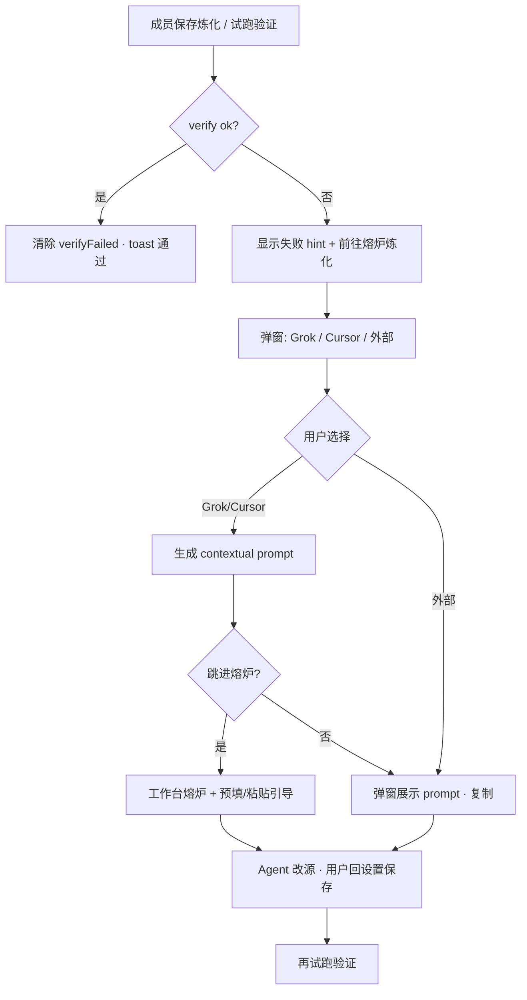

# 6.8.0 计划：试跑失败 → 熔炉炼化衔接（RFV）

> **定位**：6.5.0 已把炼化改源 diff 搬进文档中心；6.3～6.4 已交付契约保存、`verifyLast` / `verifyFailed`、熔炉/外部 Agent 两段 **静态** Skill 文案（`GET /docs/refine-prompt`）。  
> **缺口**（产品截图 2026-11-18）：成员抽屉里「试跑验证」失败（如 `EXIT`）后，用户只剩 **还原**、**文档中心** 与底部 textarea 复制，**没有**「带着失败上下文去熔炉对话修脚本」的一键动线。  
> **6.8.0**：在试跑失败旁增加 **「前往熔炉炼化」**，弹窗选择 **Grok 熔炉 / Cursor 熔炉 / 仅复制 Prompt（外部 Agent）**，要么跳进工作台熔炉并注入上下文，要么展示可复制的炼化 Prompt，继续 Agent 对话直到 `verify-member` 通过。  
> **约束**：本版 **只规划 + 实现衔接 UX 与 Prompt 组装**；不替代 `applyRefineOnMemberSave` 引擎、不新开炼化算法分支。

标注：**P0** 本版核心；**P1** 重要；**P2** 增强。状态 `[ ]` / `[x]` 维护。

---

## 一、现状（读代码确认）

### 1.1 试跑验证链

| 环节 | 实现 |
| --- | --- |
| 同步探针 | `verifyMemberSync`（`server/src/memberVerify.js`）：pipe 跑脚本，`ACW_HUMAN_INPUT=acw-verify-probe`，炼化成员检查 stdout `###` 标题 |
| 落库 | `config.refine.verifyLast`（`ok` / `checks[]` / `elapsedMs` / `stdoutPreview`…）、失败时 `verifyFailed: true` |
| 设置 UI | `Members.vue`：「试跑验证」按钮；`verifyLastHint` 显示「最近一次试跑未通过: EXIT」等；`el-alert` 链到 `/docs` + 文案引导还原 |
| 保存后 | `persistRefineOnSave` 可选自动 verify（5.9 M1），失败 toast + `verifyFailed`，**不自动回滚** |

### 1.2 已有「炼化 Prompt」能力（未与试跑失败绑定）

| 入口 | 内容 |
| --- | --- |
| `GET /docs/refine-prompt`（无参） | `buildRefineSkillPrompt()` → 外部 Agent，写群报告 `POST /docs/refine` |
| `GET /docs/refine-prompt?kind=furnace` | `buildFurnaceRefineSkillPrompt()` → 加载 `furnace-refine-skill`，**无成员/无 verify 摘要** |
| 成员抽屉 | 两个只读 textarea +「复制」；**不出现**在试跑失败 alert 旁 |
| 熔炉工作台 | `useFurnaceWorkspace` 支持 `furnaceAgentKind` **grok \| cursor**；顶栏开熔炉 TUI，**无「从设置带着 memberId 跳转」深链** |

### 1.3 与产品预期的差距

1. 试跑失败后认知断层：用户不知道下一步该复制哪段话、该开 Grok 还是 Cursor。
2. Prompt 不含 **失败检查结果**（`checks`、`stderrPreview`、脚本路径、cwd），熔炉重复踩坑。
3. 「跳进熔炉」无路由：`/settings/members` → `/workbench` 熔炉区无 `?memberId=&refine=verify` 约定。
4. Cursor 熔炉与 Grok 熔炉能力不对称（6.4 **CUR-F** 未做 Skills 镜像）；6.8 需 **显式降级**：Cursor 路径默认「复制 Prompt + 打开工作台 Cursor 熔炉」，不承诺自动灌入 TUI。

---

## 二、6.8.0 目标

1. **试跑失败可发现**：`verifyFailed` 或最近一次 `verifyLast.ok === false` 时，在「试跑验证」按钮同一行（或 alert 内）显示 **「前往熔炉炼化」**（与「还原到炼化前」并列，不取代）。
2. **选择熔炉类型**：弹窗单选 — **Grok 熔炉** / **Cursor 熔炉** / **外部 Agent（仅 Prompt）**；记住上次选择（`localStorage` 或 `settings.refine.furnaceTarget`）。
3. **上下文 Prompt**：服务端生成 **单次任务 Prompt**（含成员名、脚本路径、炼化标题 spec、试跑 `checks` 摘要、文档中心 diff 深链）；与现有 Skill 文案 **拼接**，不单删旧接口。
4. **两种落地模式**（弹窗内 Tab 或第二步）：
   - **A. 跳进熔炉**：`router.push` 工作台，聚焦熔炉抽屉/终端，**预填首条 user 消息**（或调用现有 `furnace` 注入 API，若 6.8 前无则 P0 先做「复制后自动打开熔炉 + 剪贴板已写入」）。
   - **B. 仅展示 Prompt**：大文本框 + 复制；可选「在默认浏览器打开 Cursor」等外链（P2，依赖本机 URI 方案）。
5. **闭环提示**：Prompt 尾部固定 checklist：`backup-source` → 改源 → 设置保存 → **再点试跑验证** → 失败走还原中心。

---

## 三、用户动线

---

## 四、工程任务（RFV — Refine Verify Furnace）

### 4.1 Prompt 与 API（RFV-API）

- [x] **RFV-01 P0** `GET /members/:id/refine/verify-prompt`（或扩 `refine-prompt`：`memberId` + `target=grok|cursor|external`）  
  响应：`{ prompt, member: { id, name, filePath, workDir }, verify: verifyLast, diffUrl, skillRefs[] }`  
  组装逻辑：`buildFurnaceRefineSkillPrompt()` + `formatVerifyFailureBrief(member)` + 可选 `planRefineOnMemberSave` dry-run 文件列表一行摘要。
- [x] **RFV-02 P0** `formatVerifyFailureBrief`（`memberVerify.js` 或 `agentRefine.js` 导出）：人类可读失败原因（映射 `EXIT` →「进程非零退出」等），附 `stdoutPreview`/`stderrPreview` 截断。
- [x] **RFV-03 P1** Prompt 内嵌深链：`/docs?pane=refine&memberId=`、成员脚本绝对路径（掩码可选）、`acw-ctl verify-member --member` 一行命令。
- [ ] **RFV-04 P2** 若熔炉会话已存在：可选 `sessionId` 参数，把 Prompt 追加为 `furnaceSituation` 上下文片段（需评估 token 上限）。

### 4.2 设置页 UX（RFV-SET）

- [x] **RFV-10 P0** `Members.vue`：`verifyLastHint` 非空且失败时，在「试跑验证」旁加 **「前往熔炉炼化」**（`plain` / `type=primary`）；保存后 `verifyFailed` 的 `el-alert` 内同样加链。
- [x] **RFV-11 P0** 弹窗 `RefineFurnaceLaunchDialog.vue`（或 composable）：三选一目标 + 「跳进熔炉 / 仅复制」；loading 调 RFV-01。
- [x] **RFV-12 P0** 复制成功 toast；跳进熔炉：`/workbench?furnace=1&agent=grok|cursor&refineMemberId=`。
- [x] **RFV-13 P1** `useFurnaceSync`：开炉 + `ensureFurnaceAgent` + 剪贴板任务（TUI 粘贴）。
- [x] **RFV-14 P1** i18n：`settingsMembers.*` 中英；失败 hint 与弹窗文案统一「试跑」用语。
- [x] **RFV-15 P2** 文档中心 `DocsRefineChangesPane` 成员卡「试跑未通过」旁同款按钮（与 RFN-IO-03 失败深链互补）。

### 4.3 熔炉与 Agent 策略（RFV-FUR）

- [x] **RFV-20 P0** **Grok**：默认推荐；Prompt 指向 `.grok/skills/furnace-refine-skill`；跳进熔炉 = 开 Grok TUI + 剪贴板/prefill。
- [x] **RFV-21 P1** **Cursor**：跳进 = 开 Cursor 熔炉 tab；Prompt 注明 Skills 未镜像（CUR-F 仍后置）。
- [x] **RFV-22 P1** **外部 Agent**：沿用 `buildRefineSkillPrompt`，在 Prompt 中增加「试跑失败摘要 + 请先修脚本再 POST /docs/refine 记录结论」。
- [ ] **RFV-23 P2** 设置 → 熔炉默认成员/流（`Prefs.vue`）与弹窗「默认 Grok」联动。

### 4.4 测试与文档（RFV-QA）

- [x] **RFV-30 P0** 单测：`formatVerifyFailureBrief`、RFV-01 路由（mock member + verifyLast）。
- [x] **RFV-31 P1** `web/test/refineFurnaceLaunch.test.mjs`：弹窗状态机、query 解析（纯逻辑）。
- [x] **RFV-32 P0** 更新 `guide-script.md` §炼化「验证失败 → 熔炉」；`CODE_CHANGE.md` 随实现追加。
- [x] **RFV-33 P1** `scripts/selftest-refine-adapt.mjs` 可选断言：失败 mock 时 API prompt 含 `EXIT` 映射文案。

---

## 五、非目标（6.8.0 不做）

- 熔炉内 **自动** `PATCH /members` 保存炼化（仍须用户回设置点保存或由 `acw-ctl` 显式调用）。
- 试跑失败 **自动** 回滚 zip（保持 5.9 产品决定）。
- 替代 unified diff / 还原中心（继续 6.5 RFD 余量）。
- 6.6 / 6.7 未列出的其他大特性（见 §七）。

---

## 六、验收标准

- [ ] 成员 `runServe` 类脚本试跑返回 `EXIT` 时，抽屉内可见 **前往熔炉炼化**，点击后 3 秒内看到含失败摘要的 Prompt。
- [ ] 选 Grok +「跳进熔炉」：进入工作台熔炉，首条输入已含 Prompt 或剪贴板已复制且 UI 提示粘贴发送。
- [ ] 选「仅复制」：不跳转，复制内容与 RFV-01 一致。
- [ ] `npm run test` 新增用例通过；无回归 `memberVerify.test.js`。

---

## 七、与相邻版本关系

| 版本 | 关系 |
| --- | --- |
| **6.5.0** | 炼化 diff / 还原中心 → Prompt 中深链 `pane=refine` |
| **6.4.0** | `furnace-refine-skill`、双 Agent 熔炉 UI → RFV-20/21 基座 |
| **6.3.0** | `verifyFailed`、RFN-IO 失败深链 → RFV-15 复用 |
| **5.9.0** | 试跑探针语义不变；6.8 只加 **失败后衔接** |
| **6.6 / 6.7** | *占位：发版前若插入其他 P0，RFV 可整体顺延至 6.8.x 不切语义* |

---

## 八、待办栏（本文件）

> 汇总索引见 [`plan-backlog.md`](./plan-backlog.md) §H。

- [ ] RFV-01～03 Prompt API  
- [ ] RFV-10～13 设置 + 工作台跳进  
- [ ] RFV-20～22 三目标策略  
- [ ] RFV-30～33 测试与文档  

---

## 九、实现顺序建议（给开发 Agent）

1. **RFV-02 + RFV-01**（无 UI，可 curl 验证 Prompt 质量）  
2. **RFV-10 + RFV-11 + 复制路径**（最小可用：失败 → 弹窗 → 复制）  
3. **RFV-12 + RFV-13**（跳进熔炉 + prefill）  
4. **RFV-15 / RFV-21 / RFV-23**（P1/P2 抛光）