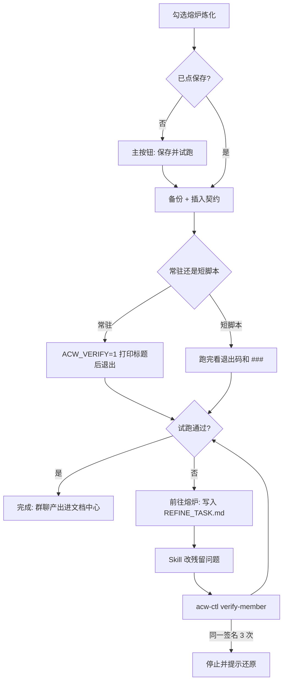

# 6.9.0 计划：熔炉炼化闭环（RCL）

> **定位**：4.5～6.8 已经把「一个开关、保存时改源、试跑、还原、diff、失败后打开熔炉」都铺上了，但成员 `runServe` 这类脚本在设置里仍然走不完。2026-11-20 的设置截图：抽屉里「熔炉炼化」已勾上、只读规格和契约预览都在，点「前往熔炉炼化」却连续弹出 **「该成员未开启炼化」**。
>
> **6.9.0 只做一件事**：让炼化从「勾选」走到「试跑通过」有唯一状态、唯一完成信号。能用确定性契约解决的，不交给模型；模型只处理契约插上之后仍然失败的残留问题，并且必须用同一次试跑当停止条件。
>
> **约束**：不新开第二种炼化、不恢复「是否适配」、不让模型重写整份脚本或 `ACW-REFINE` 块。交互式 `grok` 仍然没有 `--prompt`（见 `docs/tech-crucible-grok-client.md`），任务进工作区文件，不靠命令行预填。

标注：**P0** 本版核心；**P1** 重要；**P2** 后置。状态 `[ ]` / `[x]` 维护。本文件先规划，不改版本号（仓库仍是 6.8.0）。

---

## 一、截图上的报错是什么

红条文案只有一处来源：`GET /api/members/:id/refine/verify-prompt` 在库里的 `config.refine.enabled !== true` 时返回 400，`code: REFINE_DISABLED`（`server/src/routes/catalogRoutes.js`）。弹窗一打开就请求这个接口（`RefineFurnaceLaunchDialog.vue` 的 `watch` → `loadPrompt()`），失败用 `ElMessage.error` 抛出。截图里叠了两条一样的红条，是同一次打开打了两次请求，不是两个不同的错。

### 1.1 为什么勾着还会说「未开启」

抽屉和接口看的不是同一份状态。

| 界面上看到的 | 实际读哪里 | 截图时的结果 |
| --- | --- | --- |
| 「熔炉炼化」勾选 | 表单 `form.refine`，可与库不一致 | 勾上了 |
| 「已保存的炼化规格」 | 打开抽屉时拷进表单的 `form.config.refine.format`；`v-if` 只要求勾选为真 | 旧规格还在，所以照样显示 |
| 「最近一次试跑未通过：EXIT」 | 表单上的 `_verifyLast`，来自上次落库的 `verifyLast` | 旧失败还在 |
| 「前往熔炉炼化」按钮 | `form.refine && 试跑失败`，**不看库里的 enabled** | 按钮出现 |
| 契约预览「【将改】…bat」 | `POST /members/refine/plan` 用**表单**里的 `enabled: true` 做 dry-run | 磁盘上还没有 `ACW-REFINE`，所以预览是整段插入 |
| 红条 | `GET verify-prompt` 用 **`getMember` 读库** | 库里 `enabled` 仍是 false → 400 |

能同时满足上表的路径：

1. 这个成员曾经炼化过：规格、`verifyLast`、`verifyFailed` 写进了 `config.refine`。
2. 之后还原，或取消勾选再保存。`restoreMemberRefine` / `restoreSourceByManifest` 把 `enabled` 写成 false，并用 `...prev` **原样留下** `format`、`verifyLast`、`verifyFailed`（`server/src/refineRestore.js`）。源文件上的契约块被剥掉。
3. 再次打开抽屉，勾选框按库里的 `enabled` 初始是关的。用户重新勾上，**还没点成员保存**。
4. 勾上之后：旧规格、旧 EXIT、预览 diff 一起出现，按钮也可点。点「前往熔炉炼化」读的仍是未保存的库记录。

所以这不是「炼化开关坏了」，是 **未保存的勾选被当成了已开启**。预览接口认表单，熔炉接口认库，两条路对同一勾选给出相反答案。

### 1.2 为什么是两条红条

`RefineFurnaceLaunchDialog.vue` 的 `watch` 依赖 `[visible, memberId, target]`，回调里又执行 `target = readRefineFurnaceTarget()` 再 `loadPrompt()`。

- 弹窗一出现就请求，不等用户点「复制」或「跳进熔炉」。
- 本地记住的熔炉和单选默认值不一致时，回调改写 `target`，watch 再进一次，第二次请求再吐一条相同的 toast。
- 用户改单选也会进这个 watch，并被写回 localStorage 里的旧值，选项弹不稳。

### 1.3 `EXIT` 本身也过不了闭环

`EXIT` 来自 `verifyMemberSync`（`server/src/memberVerify.js`）：`spawnSync` 等到进程结束，退出码不在 `successCodes`（默认只有 0）里，就记 `probe_run`，detail 为 `EXIT`，**直接返回**，不再看 stdout 里有没有 `###` 标题。

`runServe.bat` 这类启动服务的脚本不该为了试跑以 0 退出。现行契约（`refineBlock`）只是在文件头部 `echo ### 标题`，然后落入原来的服务启动逻辑。试跑要么非 0 退出（就是这条 EXIT），要么一直不退出直到 30 秒超时。保存成功之后，熔炉 prompt 也修不好这个判定：完成信号选错了。

---

## 二、已经做了什么

一条链，分几版叠上去。用户侧名字只有「熔炉炼化」。

| 版本 | 已落地 | 文件 |
| --- | --- | --- |
| 4.5 | 成员 `config.refine`、跑完后把产出整理进台账 | `server/src/refine.js`、`engine/advance.js` |
| 5.9 | 保存后 pipe 试跑，`verifyLast` / `verifyFailed`；失败不自动回滚 | `memberVerify.js`、`services.persistRefineOnSave` |
| 6.2 | 去掉「是否适配」，只留炼化开关 | 设置 / 群模板 / `advance` |
| 6.3 | 保存时备份并插入幂等 `ACW-REFINE`；输入走 `ACW_*`，输出走 stdout `###`；`furnace-refine-skill` 与外部写群报告的 `agent-refine-skill` 分开 | `refineSource.js`、`guide-script.md`、`skills/furnace-refine-skill` |
| 6.4 | 熔炉手册进 `.grok/skills`，不再把长手册塞进 AGENTS 标记块 | `furnaceSkillSync.js` |
| 6.5 | 保存前 / 保存后同一套 unified diff；文档中心可看改源 | `refineDiff.js`、`DocsRefineChangesPane.vue` |
| 6.8 | 试跑失败旁「前往熔炉炼化」：Grok / Cursor / 外部三选一，生成带失败摘要的 prompt，跳进工作台时写入剪贴板 | `refineVerifyPrompt.js`、`RefineFurnaceLaunchDialog.vue`、`useFurnaceSync.js` |

保存成功时的机械链路是通的：勾选并保存 → zip 备份 → 按扩展名插入契约 → 写入 `format` → `spawnSync` 试跑 → 通过则 `status=done` 并清掉 `verifyFailed`。群聊跑完再由 `refineOutputForNode` 把正文写入 `nodes/step-*.md`。

### 2.1 闭环断在哪

```text
勾选（表单）
  → 保存（这时 enabled 才为 true，契约才进文件）
    → 试跑
      → 通过：文档中心能收到 ### 正文          ← 短脚本可以到这里
      → 失败 EXIT / 超时：
          前往熔炉
            → 立刻按「库里的 enabled」拦下      ← 截图卡在这里（还没保存）
            → 即便已保存，也只把 prompt 放进剪贴板
            → 交互式 grok 不能用 --prompt 灌第一句
            → Skill 写了要跑 verify-member，没有人强制再跑
            → 没有「同一次失败签名最多试 3 次」的停止条件
          用户自己回设置再点试跑                   ← 产品把这一步当成用户记忆
```

另外几处还敞着（`docs/plan-backlog.md`）：

- 试跑失败的流程轨没有链到该成员最近一次 diff（RFD-21）。
- `refine.format.title` 只读，用户不能改标题（RFN-F）。
- Cursor 熔炉没有把 Skills 镜像到 `.cursor/rules`（CUR-F）。6.8 对 Cursor 的降级说明仍是未勾的 RFV-21。
- 还原中心与设置文案里还有历史「适配」字样（DEBT-02）。

### 2.2 两个 Skill 被放进了同一步

「前往熔炉炼化」的第三个选项是「外部 Agent（只写群报告）」。那条 Skill 走 `POST /api/docs/refine`，**不改源、不试跑**。试跑失败时把它和 Grok 熔炉并列，用户会以为选它就能修好 `runServe.bat`。

---

## 三、外面在用的做法，以及本仓库该抄哪一段

查过的都是同一条脊柱：**先有一个机器能判定的失败，再改代码，再跑同一次检查；模型不宣布完成。**

| 来源 | 做法 | 对炼化的含义 |
| --- | --- | --- |
| [Aider `--auto-test`](https://loopengineering.wiki/wiki/closed-loop-iteration) | 每次编辑后跑固定测试命令，失败输出回到下一轮；git diff 是改动记录 | 停止条件用现成的 `verify-member`，不要新写一套「看起来像炼化好了」 |
| [SWE-agent / 修复综述](https://arxiv.org/html/2506.23749v2) | 工具集合固定（读、改、跑测试），循环是手写的，模型只选下一步 | 熔炉 Skill 保持 checklist，不要让模型发明第二种契约 |
| [Meta 测试失败修复](https://arxiv.org/abs/2507.18755) | 从失败测试出发，补丁过后重跑**同一条**测试，再给人审 | 熔炉修好后必须再打当前成员的试跑；diff 仍走 6.5 的还原中心，人点保存 / 还原 |
| [Anthropic Skills 编写说明](https://platform.claude.com/docs/en/agents-and-tools/agent-skills/best-practices) | 能用脚本定下来的不要留给模型；关键步骤要有反馈环 | `ACW-REFINE` 继续由 `refineSource.js` 插入。模型不重写这块 |
| [验证型 Skill](https://academy.claude.com/courses/claude-code-in-action/verification-skills) | 「做完了」等于检查跑过且附上结果，不是读 diff 觉得对 | `verifyLast.ok === true` 是唯一完成态 |

不采用的默认路径：

- **让模型重写整个 bat/ps1。** 本仓库已经为全角括号把 cmd 拆行踩过坑（`repairRefineContractContent`）。契约块保持确定性插入。
- **交互式熔炉用 `grok --prompt` 灌任务。** 官方 CLI 的 `-p` 是单轮答完即退出；会话式熔炉传 `--prompt` 会报 `unexpected argument`。剪贴板粘贴同样不算注入。
- **再做一个「服务器模式 / 脚本模式」开关给用户选。** 6.2 刚收成一个炼化。运行形态从成员已有字段推断（下面 §4.2）。

---

## 四、推荐做法

三层，仍是一个开关。

### 4.1 状态只有五个，按钮跟着走

持久状态以库为准，脏表单单独算一种，不借用旧的 `verifyFailed`。

| 状态 | 判定 | 主操作 |
| --- | --- | --- |
| 未勾选 | 表单未勾 | 无炼化按钮 |
| 已勾未保存 | 表单已勾，库里 `enabled` 不是 true，或脚本/路径相对上次保存有改动 | **保存并试跑**。不打开熔炉，不请求 verify-prompt |
| 已保存，待试跑 | `enabled` 且没有 `verifyLast` | 试跑验证 |
| 试跑失败 | `enabled` 且最新一次 `verifyLast.ok === false` 且未跳过 | 看失败原因；残留失败才「前往熔炉炼化」 |
| 试跑通过 | `enabled` 且 `verifyLast.ok` | 无熔炉入口 |

还原或取消勾选并保存时，清掉 `verifyFailed`，并把 `verifyLast` 标成过期（或直接删）。过期失败不能再点亮「前往熔炉」。

「已保存的炼化规格」只在库里 `enabled` 时显示。未保存的勾选只显示契约预览，并写明「尚未写入成员」。

### 4.2 试跑按进程形态判定，不新增开关

从现有字段推断，用户无感知：

- **短脚本**（`waitForExit !== false`，且不是常驻服务）：保持今天的语义。进程必须以成功码退出，stdout 含 `###` 标题。
- **常驻**（`detach` / `waitForExit: false`，或命令像启动服务）：契约块在打完标题后认识 `ACW_VERIFY=1`，打印标题后立刻以 0 退出，**不启动服务**。试跑设置该变量。正式群聊不设置，脚本照常启动。

`runServe.bat` 走第二条。今天的 EXIT 会变成「探针打印标题后退出 0」，不必先找熔炉。

仅包装、里面只有 `start node …` 的 bat：保存时警告并默认改去炼化真正的 `node` 入口（6.3 RFN-SRC-02 从「不阻断」收成默认跳过包装文件）。用户仍可显式指定就炼这个 bat。

### 4.3 熔炉只接残留失败，任务写进文件

确定性契约 + 上面的探针仍失败（脚本自己的错误、编码、缺依赖、标题被业务逻辑冲掉）时，才打开熔炉。

1. 弹窗只保留 **Grok 熔炉** 与 **Cursor 熔炉**。写群报告的外部 Skill 留在现在的「复制炼化 Skill」框，不进这个弹窗。
2. 服务端把失败摘要写到熔炉工作区 `REFINE_TASK.md`（成员、脚本路径、`checks`、stdout/stderr 节选、`verify-member` 命令、文档中心 diff 链接）。打开熔炉时在现有 AGENTS 短引导里加一句：若该文件存在，先按 `furnace-refine-skill` 做完。
3. Skill 的完成条件写成硬句子：改完执行 `node acw-ctl.mjs verify-member --member "<名>"`，退出码 0 才停。禁止删改 `ACW-REFINE` 标记行。同一失败签名连续 3 次仍失败就停，请用户还原或改成员配置，避免在服务脚本上打转。
4. 剪贴板保留为副本，供 TUI 里手动粘贴。它不再是「已经交给熔炉」的依据。
5. Cursor 在 CUR-F 落地前，弹窗写明：任务文件同样生成，Skills 尚未镜像到 `.cursor/rules`，需对照仓库 `skills/furnace-refine-skill/SKILL.md`。

交互式 grok 读工作区文件，这和 3.7.2 以后「短引导走 AGENTS、不走 `--prompt`」是同一条路，不新加 CLI 参数。

### 4.4 弹窗请求

- 打开时不请求。用户点主按钮再生成。
- `target` 的 watch 不再在回调里覆盖单选；记住选择只在用户点主按钮时写入。
- 库里未开启时接口可以保持 400，但抽屉在「已勾未保存」时根本不发这个请求，红条不再出现。

---

## 五、用户动线



---

## 六、工程任务（RCL）

### 6.1 状态与误报（RCL-STATE）

- [ ] **RCL-01 P0** 成员抽屉炼化区按 §4.1 五态显示。`showRefineFurnaceLaunch` 改为：库里 `enabled` 且**最新**试跑失败。脏勾选只出「保存并试跑」。
- [ ] **RCL-02 P0** 还原（成员按钮与按 manifest 还原）清除 `verifyFailed`，`verifyLast` 标过期。单测锁住：还原后 `verify-prompt` 仍 400，且抽屉不显示旧 EXIT 的熔炉按钮。
- [ ] **RCL-03 P0** 「已保存的炼化规格」与契约预览文案分开：未保存时预览标题写「保存后将写入」，不叫已保存。
- [ ] **RCL-04 P0** `RefineFurnaceLaunchDialog`：去掉「打开即请求」和 watch 内回写 `target`。切目标不额外打失败 toast。主按钮在未开启时不发请求。

### 6.2 探针（RCL-PROBE）

- [ ] **RCL-05 P0** 契约块增加 `ACW_VERIFY=1` 早退（bat/cmd、ps1、sh、py、js）。正式执行不设置该变量。`runScriptProbeSync` 的 env 带上 `ACW_VERIFY=1`。
- [ ] **RCL-06 P0** 常驻成员试跑用早退语义；短脚本仍要求进程成功码 + `###`。`memberVerify.test.js` 加一支：bat 在契约之后 `exit /b 1`，探针仍因早退通过。
- [ ] **RCL-07 P1** 纯包装 bat（仅 `start` / `call` 到 node）保存时默认不改该 bat，提示改炼 node 入口。显式「就炼这个文件」可覆盖。

### 6.3 熔炉残留回路（RCL-FUR）

- [ ] **RCL-10 P1** `REFINE_TASK.md` 写到熔炉工作区；AGENTS 短引导增加一行「有该文件则先做完」。内容复用 `buildMemberRefineVerifyPrompt`，不另写一套摘要。
- [ ] **RCL-11 P1** 更新 `skills/furnace-refine-skill`：完成 = `verify-member` 退出码 0；禁止改 `ACW-REFINE` 块；同一失败签名 3 次即停。同步进 `.grok/skills` 的逻辑沿用 `furnaceSkillSync.js`。
- [ ] **RCL-12 P1** 弹窗去掉「外部 Agent（只写群报告）」。该 Skill 留在抽屉里原有的复制框。
- [ ] **RCL-13 P1** 跳进工作台仍复制一份到剪贴板，toast 写明「任务已写入熔炉工作区，剪贴板是副本」。
- [ ] **RCL-14 P2** Cursor：任务文件相同；在 CUR-F 完成前于弹窗写明 Skills 未镜像。不在本版做 `.cursor/rules` 同步。

### 6.4 文档与测试（RCL-QA）

- [ ] **RCL-20 P0** `guide-script.md` §3.2：未保存不进熔炉；常驻脚本靠 `ACW_VERIFY`；熔炉只修残留失败。
- [ ] **RCL-21 P0** 单测：脏表单不请求 verify-prompt 的纯逻辑（`web/test/refineFurnaceLaunch.test.mjs`）；还原清掉失败标记；常驻早退探针。
- [ ] **RCL-22 P1** `CODE_CHANGE.md` 随实现追加。本规划文件的台账记在添加规划的那次提交。

---

## 七、非目标

- 不把版本号抬到 6.9.0，直到本节任务开始落地。
- 不自动把熔炉改动写回成员并保存。保存仍是用户动作，或 `acw-ctl` 的显式子命令。
- 不自动回滚失败试跑（维持 5.9 的决定）。
- 不用无头 `grok -p` 代替工作台熔炉。单轮模式答完就退出，用户看不到对话。
- 不实现 CUR-F、RFD-03/13/21、RFN-F。它们留在 `plan-backlog.md`。

---

## 八、验收

- [ ] 还原后再勾选、未保存：无「该成员未开启炼化」红条；主按钮是「保存并试跑」；规格区不称「已保存」。
- [ ] 打开熔炉弹窗、切换 Grok/Cursor：失败请求最多在点主按钮时发生一次，不叠两条 toast。
- [ ] 一支「打印标题后 `exit /b 1`」的常驻 bat，保存炼化后试跑通过，且正式执行（不带 `ACW_VERIFY`）仍会跑到后面的退出。
- [ ] 短脚本行为不变：无 `###` 或非成功退出码仍失败。
- [ ] 残留失败点「前往熔炉」后，熔炉工作区出现 `REFINE_TASK.md`，内容含该成员的 EXIT 或标题缺失摘要，以及 `verify-member` 命令。
- [ ] `npm run test` 与 `npm run test:web` 通过。

---

## 九、与相邻版本

| 版本 | 关系 |
| --- | --- |
| **6.8.0** | 熔炉入口和 prompt 组装留下。6.9 改它的触发条件、请求时机和任务送达方式 |
| **6.5.0** | diff / 还原中心继续当人审界面 |
| **6.4.0** | Skill 仍是熔炉侧的操作说明；6.9 只收紧完成句和停止条件 |
| **6.3.0** | 契约插入仍是唯一改源算法 |
| **3.7.2** | 交互式 grok 不走 `--prompt`，任务文件沿用「写进工作区让 CLI 自己发现」 |

未勾索引见 [`plan-backlog.md`](./plan-backlog.md) §I。
