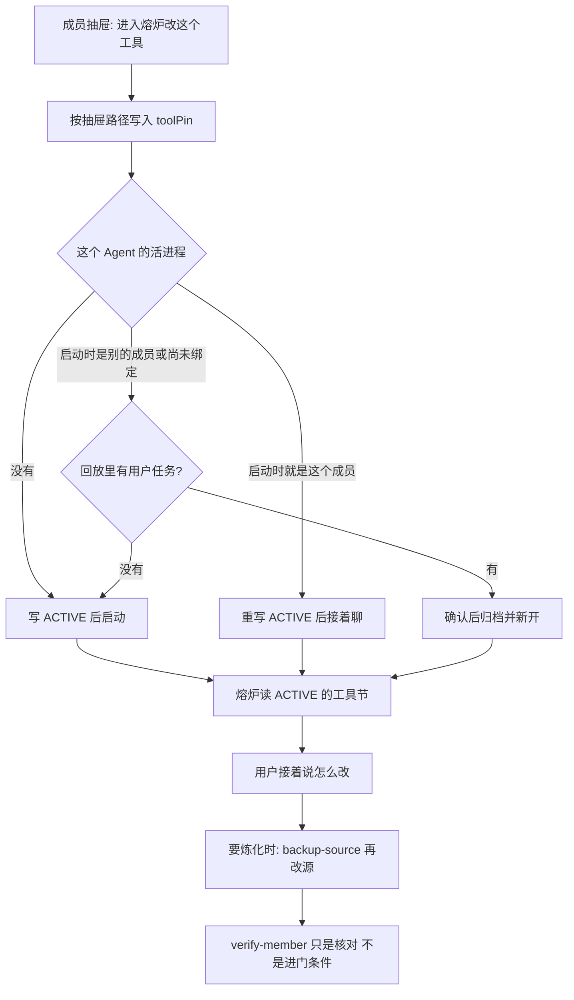
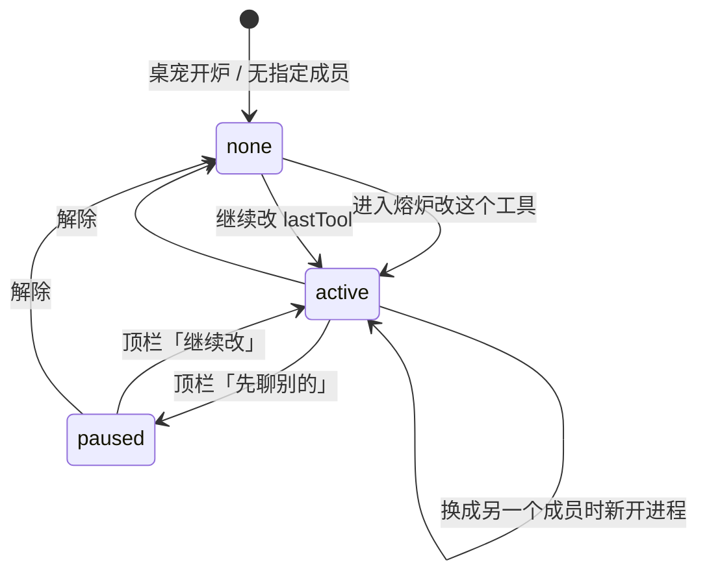

# 6.9.0 计划：熔炉炼化闭环（RCL）

> **定位**：4.5～6.8 已经把「一个开关、保存时改源、试跑、还原、diff、失败后打开熔炉」都铺上了，但成员 `runServe` 这类脚本在设置里仍然走不完。2026-11-20 的设置截图：抽屉里「熔炉炼化」已勾上、只读规格和契约预览都在，点「前往熔炉炼化」却连续弹出 **「该成员未开启炼化」**。
>
> **6.9.0 做两件事**：试跑有唯一完成信号；用户随时能进熔炉改**当前这个工具**。试跑失败只是 ACTIVE 里的一段上下文，不是进熔炉的门票。进熔炉之后靠 `ACTIVE.md` 的「本轮要改的工具」接上脚本路径，换工具时按下面的规则决定接着聊还是新开。
>
> **约束**：不新开第二种炼化、不恢复「是否适配」、不让模型重写整份脚本或 `ACW-REFINE` 块。交互式 `grok` 仍然没有 `--prompt`（见 `docs/tech-crucible-grok-client.md`），任务进工作区文件，不靠命令行预填。

标注：**P0** 本版核心；**P1** 重要；**P2** 后置。状态 `[ ]` / `[x]` 维护。仓库版本 **6.9.0**。纯包装 bat 默认不改（RCL-07）仍未做。

---

## 一、截图上的报错是什么

红条文案只有一处来源：`GET /api/members/:id/refine/verify-prompt` 在库里的 `config.refine.enabled !== true` 时返回 400，`code: REFINE_DISABLED`（`server/src/routes/catalogRoutes.js`）。弹窗一打开就请求这个接口（`RefineFurnaceLaunchDialog.vue` 的 `watch` → `loadPrompt()`），失败用 `ElMessage.error` 抛出。截图里叠了两条一样的红条，是同一次打开打了两次请求，不是两个不同的错。

### 1.1 为什么勾着还会说「未开启」

抽屉和接口看的不是同一份状态。

| 界面上看到的 | 实际读哪里 | 截图时的结果 |
| --- | --- | --- |
| 「熔炉炼化」勾选 | 表单 `form.refine`，可与库不一致 | 勾上了 |
| 「已保存的炼化规格」 | 打开抽屉时拷进表单的 `form.config.refine.format`；`v-if` 只要求勾选为真 | 旧规格还在，所以照样显示 |
| 「最近一次试跑未通过：EXIT」 | 表单上的 `_verifyLast`，来自上次落库的 `verifyLast` | 旧失败还在 |
| 「前往熔炉炼化」按钮 | `form.refine && 试跑失败`，**不看库里的 enabled** | 按钮出现 |
| 契约预览「【将改】…bat」 | `POST /members/refine/plan` 用**表单**里的 `enabled: true` 做 dry-run | 磁盘上还没有 `ACW-REFINE`，所以预览是整段插入 |
| 红条 | `GET verify-prompt` 用 **`getMember` 读库** | 库里 `enabled` 仍是 false → 400 |

能同时满足上表的路径：

1. 这个成员曾经炼化过：规格、`verifyLast`、`verifyFailed` 写进了 `config.refine`。
2. 之后还原，或取消勾选再保存。`restoreMemberRefine` / `restoreSourceByManifest` 把 `enabled` 写成 false，并用 `...prev` **原样留下** `format`、`verifyLast`、`verifyFailed`（`server/src/refineRestore.js`）。源文件上的契约块被剥掉。
3. 再次打开抽屉，勾选框按库里的 `enabled` 初始是关的。用户重新勾上，**还没点成员保存**。
4. 勾上之后：旧规格、旧 EXIT、预览 diff 一起出现，按钮也可点。点「前往熔炉炼化」读的仍是未保存的库记录。

所以这不是「炼化开关坏了」，是 **未保存的勾选被当成了已开启**。预览接口认表单，熔炉接口认库，两条路对同一勾选给出相反答案。

### 1.2 为什么是两条红条

`RefineFurnaceLaunchDialog.vue` 的 `watch` 依赖 `[visible, memberId, target]`，回调里又执行 `target = readRefineFurnaceTarget()` 再 `loadPrompt()`。

- 弹窗一出现就请求，不等用户点「复制」或「跳进熔炉」。
- 本地记住的熔炉和单选默认值不一致时，回调改写 `target`，watch 再进一次，第二次请求再吐一条相同的 toast。
- 用户改单选也会进这个 watch，并被写回 localStorage 里的旧值，选项弹不稳。

### 1.3 `EXIT` 本身也过不了闭环

`EXIT` 来自 `verifyMemberSync`（`server/src/memberVerify.js`）：`spawnSync` 等到进程结束，退出码不在 `successCodes`（默认只有 0）里，就记 `probe_run`，detail 为 `EXIT`，**直接返回**，不再看 stdout 里有没有 `###` 标题。

`runServe.bat` 这类启动服务的脚本不该为了试跑以 0 退出。现行契约（`refineBlock`）只是在文件头部 `echo ### 标题`，然后落入原来的服务启动逻辑。试跑要么非 0 退出（就是这条 EXIT），要么一直不退出直到 30 秒超时。保存成功之后，熔炉 prompt 也修不好这个判定：完成信号选错了。

---

## 二、已经做了什么

一条链，分几版叠上去。用户侧名字只有「熔炉炼化」。

| 版本 | 已落地 | 文件 |
| --- | --- | --- |
| 4.5 | 成员 `config.refine`、跑完后把产出整理进台账 | `server/src/refine.js`、`engine/advance.js` |
| 5.9 | 保存后 pipe 试跑，`verifyLast` / `verifyFailed`；失败不自动回滚 | `memberVerify.js`、`services.persistRefineOnSave` |
| 6.2 | 去掉「是否适配」，只留炼化开关 | 设置 / 群模板 / `advance` |
| 6.3 | 保存时备份并插入幂等 `ACW-REFINE`；输入走 `ACW_*`，输出走 stdout `###`；`furnace-refine-skill` 与外部写群报告的 `agent-refine-skill` 分开 | `refineSource.js`、`guide-script.md`、`skills/furnace-refine-skill` |
| 6.4 | 熔炉手册进 `.grok/skills`，不再把长手册塞进 AGENTS 标记块 | `furnaceSkillSync.js` |
| 6.5 | 保存前 / 保存后同一套 unified diff；文档中心可看改源 | `refineDiff.js`、`DocsRefineChangesPane.vue` |
| 6.8 | 试跑失败旁「前往熔炉炼化」：Grok / Cursor / 外部三选一，生成带失败摘要的 prompt，跳进工作台时写入剪贴板 | `refineVerifyPrompt.js`、`RefineFurnaceLaunchDialog.vue`、`useFurnaceSync.js` |

保存成功时的机械链路是通的：勾选并保存 → zip 备份 → 按扩展名插入契约 → 写入 `format` → `spawnSync` 试跑 → 通过则 `status=done` 并清掉 `verifyFailed`。群聊跑完再由 `refineOutputForNode` 把正文写入 `nodes/step-*.md`。

### 2.1 闭环断在哪

```text
勾选（表单）
  → 保存（这时 enabled 才为 true，契约才进文件）
    → 试跑
      → 通过：文档中心能收到 ### 正文          ← 短脚本可以到这里
      → 失败 EXIT / 超时：
          前往熔炉
            → 立刻按「库里的 enabled」拦下      ← 截图卡在这里（还没保存）
            → 即便已保存，也只把 prompt 放进剪贴板
            → `refineMemberId` 开炉后就从地址栏删掉，服务端开进程时不读它
            → 熔炉 cwd 是 `data/furnace/`（或自定义 workspace），不是工具目录
            → 交互式 grok 不能用 --prompt 灌第一句；已经在跑的进程也不会重读刚改的文件
            → Skill 写了要跑 verify-member，没有人强制再跑
            → 没有「同一次失败签名最多试 3 次」的停止条件
          用户自己回设置再点试跑                   ← 产品把这一步当成用户记忆
```

另外几处还敞着（`docs/plan-backlog.md`）：

- 试跑失败的流程轨没有链到该成员最近一次 diff（RFD-21）。
- `refine.format.title` 只读，用户不能改标题（RFN-F）。
- Cursor 熔炉没有把 Skills 镜像到 `.cursor/rules`（CUR-F）。6.8 对 Cursor 的降级说明仍是未勾的 RFV-21。
- 还原中心与设置文案里还有历史「适配」字样（DEBT-02）。

### 2.2 两个 Skill 被放进了同一步

「前往熔炉炼化」的第三个选项是「外部 Agent（只写群报告）」。那条 Skill 走 `POST /api/docs/refine`，**不改源、不试跑**。试跑失败时把它和 Grok 熔炉并列，用户会以为选它就能修好 `runServe.bat`。

---

## 三、外面在用的做法，以及本仓库该抄哪一段

查过的都是同一条脊柱：**先有一个机器能判定的失败，再改代码，再跑同一次检查；模型不宣布完成。**

| 来源 | 做法 | 对炼化的含义 |
| --- | --- | --- |
| [Aider `--auto-test`](https://loopengineering.wiki/wiki/closed-loop-iteration) | 每次编辑后跑固定测试命令，失败输出回到下一轮；git diff 是改动记录 | 停止条件用现成的 `verify-member`，不要新写一套「看起来像炼化好了」 |
| [SWE-agent / 修复综述](https://arxiv.org/html/2506.23749v2) | 工具集合固定（读、改、跑测试），循环是手写的，模型只选下一步 | 熔炉 Skill 保持 checklist，不要让模型发明第二种契约 |
| [Meta 测试失败修复](https://arxiv.org/abs/2507.18755) | 从失败测试出发，补丁过后重跑**同一条**测试，再给人审 | 熔炉修好后必须再打当前成员的试跑；diff 仍走 6.5 的还原中心，人点保存 / 还原 |
| [Anthropic Skills 编写说明](https://platform.claude.com/docs/en/agents-and-tools/agent-skills/best-practices) | 能用脚本定下来的不要留给模型；关键步骤要有反馈环 | `ACW-REFINE` 继续由 `refineSource.js` 插入。模型不重写这块 |
| [验证型 Skill](https://academy.claude.com/courses/claude-code-in-action/verification-skills) | 「做完了」等于检查跑过且附上结果，不是读 diff 觉得对 | `verifyLast.ok === true` 是唯一完成态 |

不采用的默认路径：

- **让模型重写整个 bat/ps1。** 本仓库已经为全角括号把 cmd 拆行踩过坑（`repairRefineContractContent`）。契约块保持确定性插入。
- **交互式熔炉用 `grok --prompt` 灌任务。** 官方 CLI 的 `-p` 是单轮答完即退出；会话式熔炉传 `--prompt` 会报 `unexpected argument`。剪贴板粘贴同样不算注入。
- **再做一个「服务器模式 / 脚本模式」开关给用户选。** 6.2 刚收成一个炼化。运行形态从成员已有字段推断（下面 §4.2）。

---

## 四、推荐做法

三层，仍是一个开关。

### 4.1 炼化状态和进熔炉是两件事

炼化五态只管契约和试跑。**「进入熔炉改这个工具」不看试跑成不成功**，只要这个成员已经有 id、并且抽屉里能解析出脚本路径或命令。

| 炼化状态 | 判定 | 炼化区主操作 |
| --- | --- | --- |
| 未勾选 | 表单未勾 | 无「保存并试跑」 |
| 已勾未保存 | 表单已勾，库里 `enabled` 不是 true，或脚本/路径相对上次保存有改动 | **保存并试跑** |
| 已保存，待试跑 | `enabled` 且没有 `verifyLast` | 试跑验证 |
| 试跑失败 | `enabled` 且最新一次 `verifyLast.ok === false` 且未跳过 | 看失败原因 |
| 试跑通过 | `enabled` 且 `verifyLast.ok` | 无额外炼化动作 |

旁边始终可以「进入熔炉改这个工具」（有 id 且有路径）。没有 id：先保存成员。没有路径：按钮改为普通「打开熔炉」，不写工具绑定。

还原或取消勾选并保存时，清掉 `verifyFailed`，并把 `verifyLast` 标成过期。过期失败不再写进新的绑定；按钮本身还在。

「已保存的炼化规格」只在库里 `enabled` 时显示。未保存的勾选只显示契约预览，并写明「尚未写入成员」。绑定若发生在未保存时，ACTIVE 里写明「按抽屉里的路径，尚未落库」。

### 4.2 试跑按进程形态判定，不新增开关

从现有字段推断，用户无感知：

- **短脚本**（`waitForExit !== false`，且不是常驻服务）：保持今天的语义。进程必须以成功码退出，stdout 含 `###` 标题。
- **常驻**（`detach` / `waitForExit: false`，或命令像启动服务）：契约块在打完标题后认识 `ACW_VERIFY=1`，打印标题后立刻以 0 退出，**不启动服务**。试跑设置该变量。正式群聊不设置，脚本照常启动。

`runServe.bat` 走第二条。今天的 EXIT 会变成「探针打印标题后退出 0」，不必先找熔炉。

仅包装、里面只有 `start node …` 的 bat：保存时警告并默认改去炼化真正的 `node` 入口（6.3 RFN-SRC-02 从「不阻断」收成默认跳过包装文件）。用户仍可显式指定就炼这个 bat。

### 4.3 弹窗不再为了进熔炉打 verify-prompt

进熔炉改工具不经过 `GET verify-prompt`，因此未开启炼化也不会再弹出那条红字。失败摘要在绑定时从库里的 `verifyLast` 读，没有就空着。

- 打开弹窗不请求。`target` 的 watch 不再在回调里回写单选。
- 弹窗只保留 **Grok** 与 **Cursor**。写群报告的外部 Skill 留在抽屉里原来的复制框。
- 点「进入」之后的连接、重启、接着聊，全部按下一节。剪贴板不再当连接。

---

## 五、用 ACTIVE 接上当前工具

是。连接走 `ACTIVE.md`，不另写 `REFINE_TASK.md`，也不把熔炉进程的 cwd 改到工具目录。

今天 grok 启动时读的是工作区里的 `AGENTS.md` 短引导，短引导写明细节在 `ACTIVE.md`（`furnaceGrokInject.composeAgentsInner`）。交互式进程没有 `--prompt`，已经跑起来的进程也不会因为别人改了磁盘上的 md 就自动看到新内容。所以：**绑定必须写进 ACTIVE，而且要在这次进程启动之前写好**；换了工具、旧对话还在讲上一份脚本时，就要新开进程，让新进程读到新的 ACTIVE。

熔炉 cwd 继续是 `data/furnace/` 或设置里的 `grok.workspaceDir`。工具用绝对路径指过去。`acw-ctl` 用成员 id。不把 `AGENTS.md` 写进用户的工具仓库（6.4 已经把这件事标成风险）。

### 5.1 绑定放在 `active.json`，ACTIVE 只是它的投影

`activateFurnaceRole` 每次都整篇重写 `ACTIVE.md`。群聊游标一动，`touchFurnaceWorkflow` 会再走一遍。若工具路径只塞进「此刻在做什么」那段情境文字，下一次工作流刷新就把它冲掉。

因此：

| 落点 | 内容 | 谁改 |
| --- | --- | --- |
| `active.json` 的 `toolPin` | 成员 id、抽屉路径、是否未保存、绑定代次 `generation`、写进去的时间 | 用户点「进入熔炉改这个工具」，或点「解除绑定」 |
| `ACTIVE.md` 的 `## 本轮要改的工具` | 由 `toolPin` 渲染出来的那一节 | 每次 `activateFurnaceRole` 都重画，包括工作流刷新 |
| `ACTIVE.md` 的 `## 此刻在做什么` | 群聊节点地图，和现在一样 | 工作流游标 |
| `AGENTS.md` 标记块多一行 | 有 `toolPin` 时：「本轮要改的工具在 ACTIVE.md 那一节，先读再改文件。」 | 和 ACTIVE 同一次写 |

自定义 workspace 与 `data/furnace/` 不是同一目录时，`maybeInjectGrokFurnace` 已经会把 ACTIVE 拷到进程 cwd。工具节必须在 `pack.text` 里，两份才一致。

工作流刷新不清除 `toolPin`。角色只在姿态是 `active` 时保持 `refine`。挂起或解除后回到主持（闸门进行中则仍是审核），避免人已经在聊别的，角色壳还锁在炼化上。

### 5.2 那一节写什么

短、固定字段，方便模型形成习惯。试跑失败只是其中一行，可以空。

```markdown
## 本轮要改的工具
- 成员：runServe（mem_…）
- 脚本：D:\ai\ai\work\runServe\runServe.bat
- 工作目录：D:\ai\ai\work\runServe
- 只改这些文件：……（collectAdaptSourcePaths）
- 炼化：已开启 | 已勾选未保存 | 未开启
- 试跑：无 | 通过 | 失败 EXIT（节选）
- 改之前：node acw-ctl.mjs backup-source --member "runServe"
- 改完可核对：node acw-ctl.mjs verify-member --member "runServe"
```

路径以**用户此刻抽屉里的路径**为准，因为人要改的是眼前这份。和库里不一致时加一行「尚未落库」。Skill 仍禁止改 `ACW-REFINE` 标记行、禁止改 sqlite。用户没要求炼化时，熔炉按这句话改工具本身，不强迫插入契约。

### 5.3 什么时候重启，什么时候接着聊

判断只看两样：这个进程启动时读到的成员，和现在要绑的成员。同一成员就接着聊；成员变了，或进程启动时还没有绑定，就新开。

Grok 和 Cursor 各算各的进程。换 Agent 不换工具时，只看被点中的那一个。

| 现状 | 进程 | 用户看见的 |
| --- | --- | --- |
| 这个 Agent 没有活进程 | 先写 ACTIVE，再启动 | 打开熔炉 |
| 活进程启动时绑的就是这个成员 | 不杀进程。路径或试跑变了只重写 ACTIVE | 「还是 runServe，接着聊。ACTIVE 已更新。」 |
| 活进程启动时是另一个成员 | 先确认，归档旧对话，再新开 | 现成的「新开并归档」确认框，文案点明从 A 换成 B |
| 活进程启动时还没有工具绑定，回放里没有用户任务 | 不确认，归档（若有开场白）后新开 | 「已按 runServe 开一轮」 |
| 活进程启动时还没有工具绑定，回放里已经有别的任务 | 先确认，再归档并新开 | 同上确认框 |
| 用户解除绑定 | 清 `toolPin`，重写 ACTIVE，不杀进程 | 「已解除绑定，接着聊」 |
| 群聊游标自己往前走 | 只重写「此刻在做什么」，不杀进程 | 无额外提示 |

「有没有用户任务」用现成的 `estimateFurnaceContext`（`furnaceReopen.js` 已拿它做新开确认）。估不到用户输入，当作空对话，直接新开。估到了，走确认。

同一成员不重启的原因：修脚本的上下文在对话里，杀掉就丢。路径更新后模型不会自动重读文件，所以 toast 写明「跟熔炉说一声：重读 ACTIVE 的本轮工具」。不往 PTY 里自动敲字。

换成员必须重启的原因：旧对话里的路径和 diff 会让模型改错文件。新进程启动时 AGENTS 才指向新的 ACTIVE。

顺序固定，不能反：

1. 写 `active.json.toolPin`（换成员时 `generation + 1`）
2. 重写 ACTIVE，并同步到进程 cwd
3. 更新 AGENTS 那一行
4. 需要新开时，再归档、再 spawn

先 spawn 再写文件，新进程可能读到上一份工具。

进程侧记住自己启动时的 `memberId`（终端元数据或 `active.json.seenBy.grok|cursor`）。下次比较用这个，不靠猜对话内容。

### 5.4 和炼化试跑的关系



试跑仍按 §4.2 单独存在。失败只写在「本轮要改的工具」的试跑行里。

### 5.5 整段生命周期：改工具、聊别的、再回来

§5.3 只回答了「换不换成员」。人还会在同一轮里停下改脚本，改问别的问题，或只是聊天，过一会又回到刚才那个成员。这三件事用**姿态**分开，不靠熔炉把用户的话分类。

`toolPin` 多一个字段 `stance`：

| 姿态 | ACTIVE 里的工具节 | 本轮任务 | 角色 |
| --- | --- | --- | --- |
| `active` | 「本轮要改的工具」 | 改这个成员 | `refine` |
| `paused` | 同一成员，标题改成「已挂起」 | 按用户这句来，不要改列出的文件，除非用户又点名这个成员 | 主持；闸门中为审核 |
| `none` | 不渲染任务节 | 自由对话或群聊主持 | 主持；闸门中为审核 |

解除或新进程丢弃任务时，把成员 id 和路径抄进 `active.json.lastTool`，只给顶栏「继续改 runServe」用，不写进任务节。

姿态只由这些动作改。用户在 TUI 里打「帮我看另一个报错」「我们聊点别的」，**不改姿态、不重启**。已经跑着的进程读不到我们的分类结果，猜错一句就会把还在改的工具卸掉。顶栏把当前姿态亮出来，人要卸任务时点按钮。顶栏加在现有 `FurnaceWorkspaceHead`。

| 顶栏 | 动作 |
| --- | --- |
| 正在改 runServe | 「先聊别的」→ `paused`；「解除」→ `none` |
| 已挂起 runServe | 「继续改」→ 回到 `active`；「解除」→ `none` |
| 未绑定 | 若有 `lastTool`，显示「继续改 runServe」 |

姿态变化和进程的对应：

| 从 → 到 | 进程 | 原因 |
| --- | --- | --- |
| `active` → `paused`（先聊别的） | 接着聊 | 要留着刚才改到哪，同时让下一句不再被工具节拉回去 |
| `paused` 或 `none` → 同一个成员的 `active`（继续改） | 默认接着聊 | 修改上下文还在这轮里。顶栏另给「新开一轮继续改」，那才归档重开 |
| `active` / `paused` → 另一个成员的 `active` | 有用户对话就确认后新开；只有开场白就直接新开 | 两份脚本的路径不能留在同一段对话里 |
| 任何姿态 → `none`（解除） | 接着聊 | 人还在这个话题里，只是不再改文件 |
| 桌宠或工作台打开熔炉，**没有**指定成员，且没有活进程 | 新进程以 `none` 启动。磁盘上若还是 `active`，先收成 `lastTool` | 上次没关干净的任务不能变成这次随便一问的默认作业 |
| 同上，但进程还活着 | 只把窗口带到前台，不改姿态 | 这轮还没结束 |
| 用户自己点「新开熔炉」 | 归档后新开，新进程读**当前**姿态 | 清的是对话，不是任务 |
| 关掉熔炉进程 | 姿态留在 `active.json` | 没有进程就没有对话可丢。下次从桌宠进来按上一行处理 |
| 群聊游标、闸门 | 只改「此刻在做什么」 | 和工具姿态无关 |

`paused` 时 AGENTS 那一行改成：「工具已挂起，见 ACTIVE。本轮按用户刚说的做，不要改那些文件，除非用户点名。」`active` 时仍是「先读工具节再改文件。」`none` 时不写这行。

Skill 同时写一句给还处在 `active`、人已经在问别的事的情况：这句若不是在说该成员，就回答这句，不要顺手改文件。姿态仍是 `active`，等用户点「先聊别的」才从任务里拿掉。这样既不猜话，又不会一句闲聊就改脚本。

点「先聊别的」会立刻改 ACTIVE 和顶栏。已经跑着的进程不会因此重读文件，这和「同一成员只刷新路径」是同一条限制。toast 写明：「已挂起。下一句直接说事；若它还在改脚本，告诉它工具已挂起。」不往 PTY 里自动敲这句。用户若要一份干干净净的空对话，用已有的「新开熔炉」。



换成员的新开规则仍是 §5.3。图里回到 `active` 的那条「换成另一个成员」表示新进程的姿态，不是原进程接着聊。

---

## 六、工程任务（RCL）

### 6.1 状态与误报（RCL-STATE）

- [x] **RCL-01 P0** 成员抽屉：有 id 且有脚本路径时始终显示「进入熔炉改这个工具」，不看试跑成败、不看 `enabled`。没有 id 时提示先保存成员。炼化五态只驱动「保存并试跑 / 试跑验证」。
- [x] **RCL-02 P0** 还原（成员按钮与按 manifest 还原）清除 `verifyFailed`，`verifyLast` 标过期。过期失败不再写进新绑定。
- [x] **RCL-03 P0** 「已保存的炼化规格」与契约预览文案分开：未保存时预览标题写「保存后将写入」，不叫已保存。
- [x] **RCL-04 P0** `RefineFurnaceLaunchDialog`：去掉「打开即请求」和 watch 内回写 `target`。进入熔炉不调用 `verify-prompt`。

### 6.2 探针（RCL-PROBE）

- [x] **RCL-05 P0** 不再往契约里插 `ACW_VERIFY` 早退。正式执行清掉该变量。保存时去掉已经插过的早退行。
- [x] **RCL-06 P0** 短脚本的非 0 退出码试跑失败。打印 `###` 后仍不退出的进程，探针短等后按常驻通过。
- [ ] **RCL-07 P1** 纯包装 bat（仅 `start` / `call` 到 node）保存时默认不改该 bat，提示改炼 node 入口。显式「就炼这个文件」可覆盖。

### 6.3 熔炉绑定与换工具（RCL-FUR）

- [x] **RCL-10 P0** `active.json.toolPin.stance`（`active` / `paused` / `none`）+ `lastTool`。只有 `active` 渲染成「本轮要改的工具」并保持角色 `refine`；`paused` 渲染成「已挂起」。`touchFurnaceWorkflow` 不改姿态。
- [x] **RCL-11 P0** 开炉顺序：先写姿态和 ACTIVE，再按 §5.3 与 §5.5 决定启动或接着聊。换成员才新开；先聊别的、解除、继续改同一成员都接着聊。桌宠开炉且无活进程时，遗留的 `active` 收成 `lastTool`，新进程以 `none` 启动。
- [x] **RCL-15 P0** `FurnaceWorkspaceHead` 焦点条：正在改 / 已挂起 / 未绑定，对应「先聊别的」「继续改」「解除」。TUI 里打字不改姿态。
- [x] **RCL-12 P1** 弹窗去掉「外部 Agent（只写群报告）」。该 Skill 留在抽屉里原有的复制框。
- [x] **RCL-13 P1** `furnace-refine-skill`：先读 ACTIVE 的工具节；只改列出的文件；改源前 `backup-source`；禁止改 `ACW-REFINE` 标记行。用户这句若不是在说该成员，就回答，不要顺手改文件。用户没要求炼化时不插入契约。同一失败签名 3 次即停。
- [x] **RCL-14 P2** Cursor 与 Grok 共用同一份 `toolPin`，各自记 `seenBy`。CUR-F 仍不做；弹窗写明 Cursor 侧 Skills 未镜像。

### 6.4 文档与测试（RCL-QA）

- [x] **RCL-20 P0** `guide-script.md` §3.2：进熔炉不要求试跑失败；工具连接在 ACTIVE；姿态 `active` / `paused` / `none`；换成员新开，先聊别的和解除都接着聊；常驻脚本靠 `ACW_VERIFY`。
- [x] **RCL-21 P0** 单测：工作流刷新不改姿态；同成员不重启、换成员要新开；`active`→`paused` 不重启；无成员的新进程把遗留 `active` 收成 `lastTool`；还原清掉失败标记；常驻早退探针；进熔炉不调用 verify-prompt。
- [x] **RCL-22 P1** `CODE_CHANGE.md` 随实现追加。本规划文件的台账记在添加规划的那次提交。

---

## 七、非目标

- 不把版本号抬到 6.9.0，直到本节任务开始落地。
- 不自动把熔炉改动写回成员并保存。保存仍是用户动作，或 `acw-ctl` 的显式子命令。
- 不自动回滚失败试跑（维持 5.9 的决定）。
- 不用无头 `grok -p` 代替工作台熔炉。单轮模式答完就退出，用户看不到对话。
- 不把熔炉 cwd 改到工具目录，也不另写 `REFINE_TASK.md`。
- 不往正在跑的 PTY 里自动敲「请重读 ACTIVE」。
- 不解析 TUI 里的话来猜测用户是不是还在改工具。
- 不实现 CUR-F、RFD-03/13/21、RFN-F。它们留在 `plan-backlog.md`。

---

## 八、验收

- [ ] 未开启炼化的已保存脚本成员，点「进入熔炉改这个工具」不出现「该成员未开启炼化」。ACTIVE 出现该成员的绝对路径。
- [ ] 熔炉已开着且绑定的就是这个成员：再进一次不杀进程，toast 为接着聊。
- [ ] 熔炉已开着且绑定的是另一个成员，回放里有用户对话：先确认，确认后旧对话进文档中心，新进程读到的是新成员。
- [ ] 熔炉开着但只是开场白、尚未绑定：直接新开，不弹确认。
- [ ] 群聊推进一步之后，`## 本轮要改的工具` 仍是刚才那个成员。
- [ ] 解除绑定后该节消失，进程还在。顶栏「先聊别的」后标题变为「已挂起」，进程还在，角色不再锁在炼化。
- [ ] 从桌宠打开熔炉且当时没有活进程：ACTIVE 里没有「本轮要改的工具」；顶栏仍可「继续改」上次的成员。
- [ ] 打开熔炉弹窗、切换 Grok/Cursor：不因为未开启炼化打出红条。
- [ ] 一支「打印标题后 `exit /b 1`」的常驻 bat，保存炼化后试跑通过，且正式执行（不带 `ACW_VERIFY`）仍会跑到后面的退出。
- [ ] 短脚本行为不变：无 `###` 或非成功退出码仍失败。
- [ ] `npm run test` 与 `npm run test:web` 通过。

---

## 九、与相邻版本

| 版本 | 关系 |
| --- | --- |
| **6.8.0** | 熔炉入口留下。6.9 改成随时可进，连接改走 ACTIVE，不再靠剪贴板和 `verify-prompt` |
| **3.2** | ACTIVE 仍是「本轮在做什么」。工具绑定是其中独立的一节，不跟节点地图混写 |
| **6.5.0** | diff / 还原中心继续当人审界面 |
| **6.4.0** | Skill 仍是熔炉侧的操作说明；6.9 只收紧完成句和停止条件 |
| **6.3.0** | 契约插入仍是唯一改源算法 |
| **3.7.2** | 交互式 grok 不走 `--prompt`，任务文件沿用「写进工作区让 CLI 自己发现」 |

未勾索引见 [`plan-backlog.md`](./plan-backlog.md) §I。
