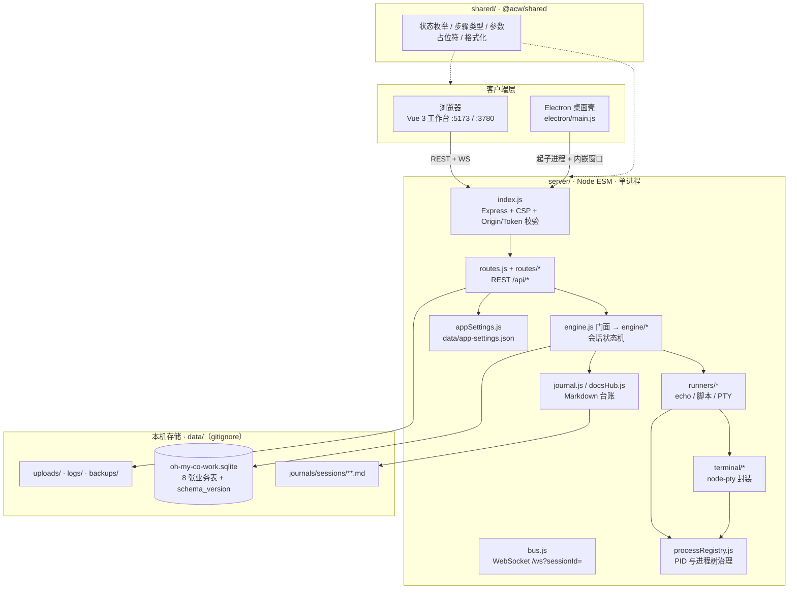
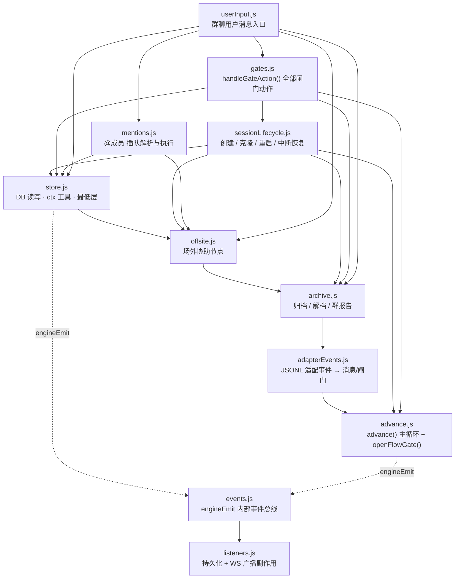
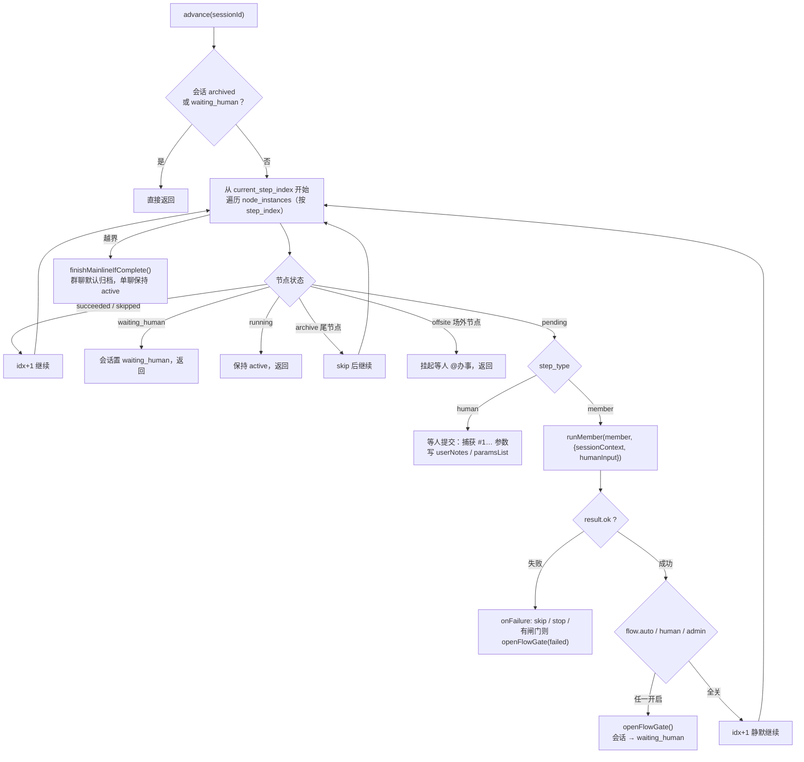
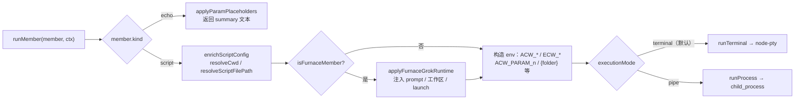
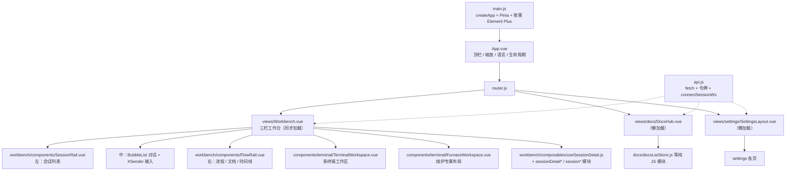
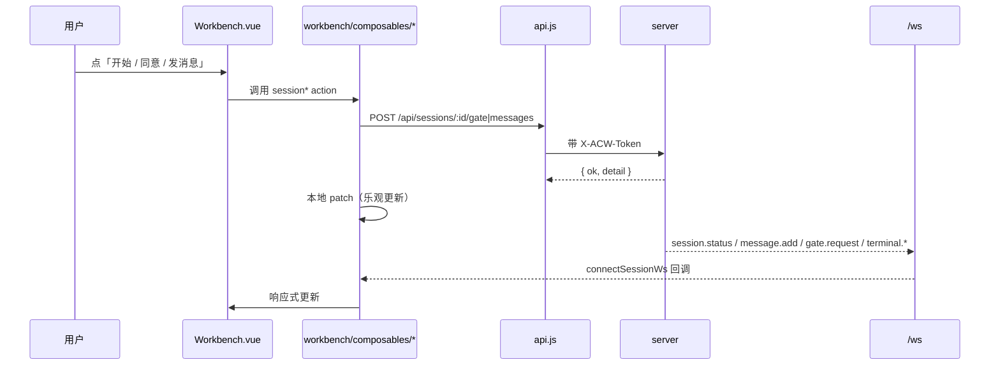
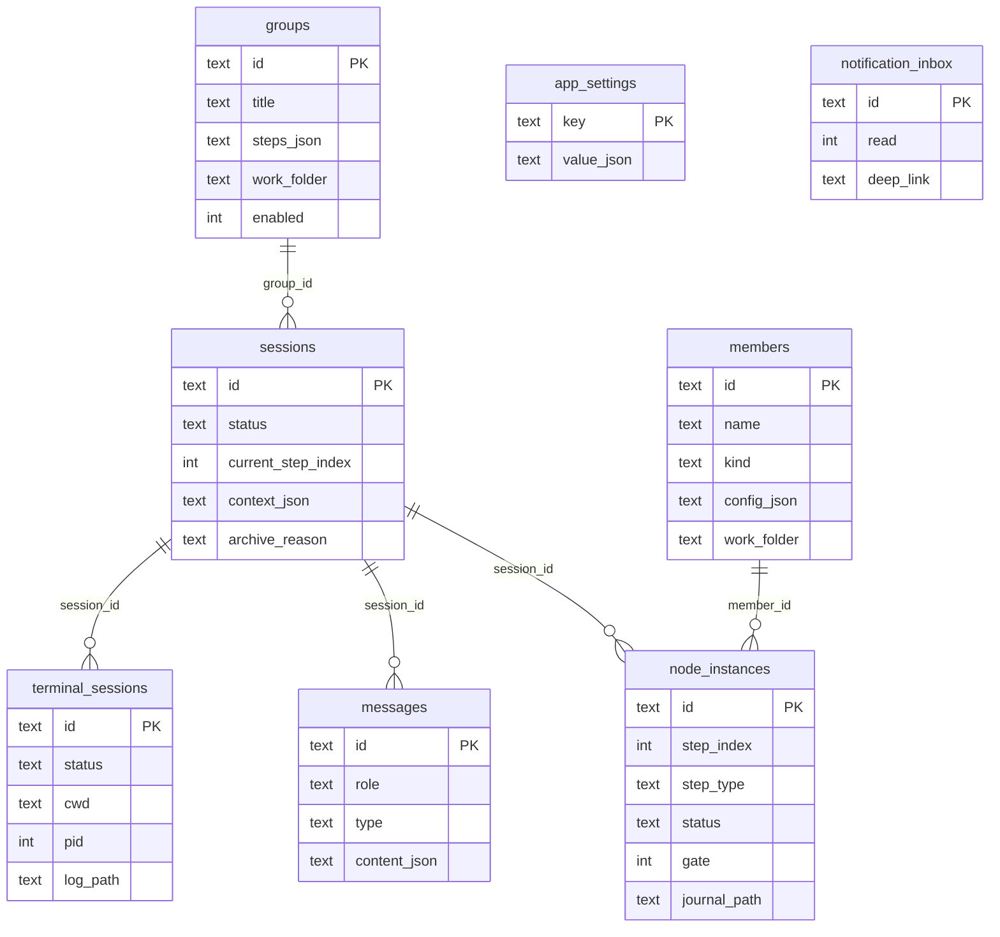

# oh-my-co-work 架构图 / 代码结构图

> 面向「第一次读这个仓库」的人：先看三张图建立骨架，再按「读码路线」钻进具体文件。
> 本文只描述**当前代码的真实形态**（v5.3.2），愿景与规划见 [tech-design.md](./tech-design.md)。
> 所有路径均以仓库根为基准，可直接 `Ctrl+P` 搜索。

## 0. 60 秒速览

一句话：**一个 Workflow（群模板）= 一个群聊；一个 Agent / 脚本 = 一个群成员；跑起来是一条会话（session）沿节点（node_instance）逐格推进，关键点停下等人表态。**

| 你关心的问题 | 一句话答案 | 去看 |
|---|---|---|
| 服务怎么起 | `server/src/index.js`：Express + ws，监听 `127.0.0.1:3780` | §2.1 |
| 状态机在哪 | `server/src/engine/advance.js` 的 `advance()` 主循环 | §3.2 |
| 数据存哪 | SQLite（8 张业务表 + `schema_version`）+ `data/journals/**.md` 台账 + `data/uploads` | §5 |
| 前端入口 | `web/src/main.js` → `App.vue` → `router.js` → `Workbench.vue` | §4 |
| 脚本 / 终端怎么跑 | `runners/runMember.js` 分流到 `runProcess`（pipe）或 `runTerminal`（PTY） | §3.4 |
| 前端 ↔ 后端怎么通信 | REST `/api/*`（Bearer/X-ACW-Token）+ WS `/ws?sessionId=` | §6 |
| 桌面壳 | `electron/main.js` 拉起 `start.mjs` 同款服务，再开窗口指过去 | §2.3 |

---

## 1. 全局架构图（运行时）



要点：

- **单进程单端口**：API、WS、静态前端（`web/dist`）都由 `server/src/index.js` 这一个 HTTP server 提供；开发期前端另起 Vite（`5173`），通过 proxy 转到 `3780`。
- **`shared/` 是唯一跨端契约**：状态枚举、步骤类型、`#1 #2` 参数解析、错误文案格式化都在这里，`server` 与 `web` 同时 import，**禁止在业务代码里硬编码这些字符串**。
- **引擎不直接碰 socket**：状态机通过内部事件总线 `engine/events.js` 发出 `persist_session` / `add_message` / `ws_broadcast_session`，由 `engine/listeners.js` 落到 DB 和 `bus.js`。

---

## 2. 进程与启动拓扑

### 2.1 服务启动顺序（`server/src/index.js`）

```mermaid
flowchart LR
  A["initDb()<br/>db.js 建表 + 迁移 + integrity_check"] --> B["markInterruptedOnBoot()<br/>未归档会话 → interrupted"]
  B --> C["markInterruptedTerminalsOnBoot()<br/>幽灵终端 → interrupted"]
  C --> D["ensureAdminMember()<br/>保证「熔炉」成员存在"]
  D --> E["老库修复<br/>demoRepair / stripScriptTimeoutMs"]
  E --> F{"空库？"}
  F -->|是| G["seed 演示流<br/>echo + script_cmd + 3 步群模板"]
  F -->|否| H["跳过"]
  G --> I["Express 中间件<br/>rejectUntrustedOrigin → cors → json → CSP"]
  H --> I
  I --> J["/api/bootstrap 公开<br/>其余 /api 走 requireLocalAccess"]
  J --> K["挂载 routes.js 及其子路由"]
  K --> L["web/dist 静态托管 + SPA fallback"]
  L --> M["WebSocketServer /ws<br/>校验 Origin + 令牌"]
  M --> N["listen 127.0.0.1:3780<br/>启动 lifecycle 心跳与本地调度器"]
```



启动阶段的「自愈」逻辑值得注意（都是幂等的）：`markInterruptedOnBoot`、`markInterruptedTerminalsOnBoot`、`ensureAdminMember`、`repairDemoKeepAliveMembers`、`stripScriptTimeoutMs`。改这些函数前先看 `server/test/demoRepair.test.js`。

### 2.2 三种入口

| 入口 | 命令 | 作用 |
|---|---|---|
| 开发双终端 | `npm run dev:server` + `npm run dev:web` | 后端 `node --watch`，前端 Vite 热更新 |
| 一键启动 | `node start.mjs` / `start.sh` / `start.bat` | 检查依赖 → 构建前端 → 起服务 → 开浏览器；`ACW_AUTO_EXIT=1` 才会随浏览器退出 |
| 桌面壳 | `npm run dev:desktop` / `electron .` | `electron/main.js` 起子进程跑服务，窗口内加载同一套页面 |

### 2.3 桌面壳（`electron/`）

`electron/main.js` 的职责边界很窄：**不重写业务**，只做进程与窗口。

```text
electron/bootstrap.cjs   进程级兜底（uncaughtException 写 data/electron.log）
electron/main.js         主进程：托盘 / 窗口 / 通知 / 更新 / 生命周期
electron/preload.cjs     暴露给渲染层的受控 API（contextBridge）
electron/lib/            urls / server(spawn+健康检查) / splash / trayState /
                         notifier / windowState / overlayBadge / shutdown / dataDir
```

渲染层仍是 `web/dist`，所以**任何前端改动都同时服务 Web 与桌面两轨**。

---

## 3. 后端代码结构（server/src）

### 3.1 目录与职责

```text
server/src/
├── index.js              # 唯一入口：中间件、WS、静态托管、启动自愈
├── routes.js             # 顶层路由汇总（health/notify/backup/fs/slash-commands）
├── routes/               # 按域拆分的子路由（见 §3.5）
├── db.js                 # better-sqlite3（Node 22 回退 node:sqlite）+ DATA_ROOT + 建表
├── engine.js             # 门面：只 re-export，保持 import 路径不变
├── engine/               # ★ 状态机全部在这里（单向依赖，无环）
├── runners.js            # 执行体门面：cwd 解析 / launch spec / runMember
├── runners/              # runMember（成员分流）、runProcess（pipe）、runTerminal 调用方
├── terminal/             # node-pty 会话、输出合批、回放、限流、适配器
├── processRegistry.js    # 所有子进程 / PTY 的统一登记与 kill
├── services.js           # 成员 / 群 / 会话的 CRUD 与查询（路由层主要落点）
├── journal.js            # 节点 Markdown 台账 + 会话 README + ANNOUNCEMENT
├── docsHub.js            # 文档中心：聚合、检索、导出、打开
├── appSettings.js        # 应用设置（存 data/app-settings.json，非 DB）
├── slashCommands.js      # 快捷指令；同时负责 ensureAdminMember（熔炉）
├── bus.js                # WS 订阅表与广播（含终端背压丢弃）
├── localAccess.js        # Origin 白名单 + 本机访问令牌
├── furnace*.js           # 「熔炉」Agent 上下文 / 生命周期 / Grok 注入
├── backup*.js / adaptBackup.js / refine*.js / step*.js   # 备份、炼化、步骤快照与回退
├── docsHub.js / auditExport.js / usageStats.js / sessionTimeline.js
└── 其余工具：fsBrowser / pathEnv / pathLock / uploads / externalNotify / notificationInbox …
```

### 3.2 引擎 DAG（读码顺序 = 依赖顺序）

`engine.js` 顶部注释就写明了依赖方向，直接照抄：



**读码顺序建议**：`shared/index.js`（枚举）→ `db.js`（表结构）→ `engine/store.js`（数据访问）→ `engine/advance.js`（主循环）→ `engine/gates.js`（人机交互）→ 其余按需。

### 3.3 `advance()` 主循环（整个系统的心脏）



关键语义（容易踩的坑）：

- **闸门三态**：`flow = { auto, human, admin }`。脚本产出成功只记 `auto` 票，仍停在 `pending`，必须点「同意 / 拒绝」；三项全关才自动流转。
- **`human_submit` 与 `approve` 不同**：前者提交参数/输入，后者是放行。
- **`#1…` 项目参数**是贯穿全局的主线：`shared/index.js` 的 `appendProjectParams` / `applyParamPlaceholders` 负责解析与替换，`session.context_json.paramsList` 是唯一事实源。

### 3.4 执行体：一次 `member` 节点怎么跑



- **默认走 PTY**（`usesTerminalExecution`：`executionMode !== 'pipe'`），所以脚本成员天然有可交互终端。
- **常驻 vs 等待退出**看 `usesKeepAlive`：内嵌终端默认常驻（节点启动成功即推进），显式 `waitForExit: true` 才等退出。演示成员曾因此卡超时，修复逻辑在 `demoRepair.js`。
- **子进程统一登记**在 `processRegistry.js`，按 `sessionId` / `memberId` 聚合；停止一律走 `killSessionProcesses` / `killMemberProcesses`，**不要直接 `process.kill`**。

### 3.5 REST 路由地图

`routes.js` 先挂通用端点，再 `router.use()` 六个子路由：

| 文件 | 前缀示例 | 主要职责 |
|---|---|---|
| `routes.js` | `/health` `/notify` `/backup*` `/fs/*` `/slash-commands*` `/support` `/runtime` `/heartbeat` `/shutdown` | 健康、外部通知、备份下载、路径浏览、快捷指令 |
| `routes/catalogRoutes.js` | `/members*` `/groups*` `/templates*` | 成员与群模板 CRUD、克隆、模板导入导出、成员炼化 |
| `routes/sessionsRoutes.js` | `/sessions*` `/resources*` `/files/*` `/messages/search` | 会话详情、节点台账、回退、时间线、终端、闸门提交、发消息、附件 |
| `routes/sessionsSystemRoutes.js` | `/diagnostics` `/usage-stats` `/agent-registry*` `/system/*` `/skills/*` `/scheduler/tick` `/mcp/connections` | 诊断、统计、Agent 注册表、数据目录迁移、内置技能与模板 |
| `routes/settingsRoutes.js` | `/settings/app` `/grok/status` `/furnace/prepare` `/about` | 应用设置读写、Grok 探测、关于页 |
| `routes/docsRoutes.js` | `/docs/*` | 文档中心列表/读取/搜索/导出/打开 |
| `routes/notificationInboxRoutes.js` | `/notification/inbox*` | 通知收件箱 |
| `routes/updateRoutes.js` | `/update/*` `/backup/import` | 检查更新、备份导入与还原 |

约定：**统一错误格式 `{ ok: false, error, code? }`**；新增路由必须同步 `web/src/api.js`。

### 3.6 终端子系统（`terminal/`）

```text
terminalService.js       对外的稳定门面：runTerminal / killTerminal / handleTerminalClientMessage
terminalRun.js           runTerminalPty()：建 entry、算配额、挂 PTY、超时、结算 Promise
ptyLaunch.js             Windows 可执行解析与命令缓存、launch 归一化
terminalOutput.js        输出合批（OUTPUT_BATCH_MS=24）与 WS 推送
terminalPersist.js       terminal_sessions 表落库
terminalLog.js / terminalQuota.js / inputLimits.js / redact.js   日志、并发配额、输入限流、脱敏
adapters/jsonl.js        文件事件适配器：watch JSONL → applyAdapterEvent（熔炉结构化通道）
clientMessage.js         WS 客户端消息协议：attach / input / resize / kill
```

WS 协议（客户端 → 服务端）：`terminal.attach`（返回 `terminal.snapshot` 回放）、`terminal.input`、`terminal.resize`、`terminal.kill`。输出侧带背压保护：`ws.bufferedAmount` 超 512KB 直接丢帧并下发 `terminal.backpressure`（见 `bus.js`）。

### 3.7 共享内核 `shared/`（1193 行的 `index.js` 是重点）

| 区块 | 关键导出 | 用途 |
|---|---|---|
| 状态枚举 | `SESSION_STATUS` `NODE_STATUS` `STEP_TYPE` `MEMBER_KIND` `FURNACE_*` | 全项目唯一字符串来源 |
| 步骤流转 | `normalizeStepFlow` `flowNeedsWait` `defaultStepFlow` | 新旧 `gate` 字段兼容 |
| 参数体系 | `appendProjectParams` `getParamsMap` `mergeSystemParams` `applyParamPlaceholders` `SYSTEM_PARAM_KEYS` | `#1…` / `#a` / `{folder}` 等 |
| 展示格式化 | `formatGroupCard` `formatBusinessIo` `abbrGroupTag` `formatSessionAutoTitle` | 群卡片、结果摘要、会话自动命名 |
| 熔炉 | `isFurnaceMember` `inferFurnaceAgent` `estimateFurnaceContext` `buildFurnacePtyAttachText` | 熔炉判定与上下文估算 |
| 子模块 | `fuzzy.js`（模糊搜索）`ptyPlain.js`（TUI 去边框）`stepParams.js` `userFacingError.js` `notificationPolicy.js` | 按需拆文件 |

---

## 4. 前端代码结构（web/src）

### 4.1 分层与入口



`main.js` 有两条强约束（改了就白屏或首包暴涨）：

1. **Element Plus 按需引入**：`vite.config.js` 用 `unplugin-vue-components` + `ElementPlusResolver`，**不要**给 `element-plus` 加 `manualChunks`（会打乱初始化顺序导致 `Cannot access 'xx' before initialization` 白屏）。
2. **`vue-element-plus-x` 只注册 3 个组件**：`BubbleList` / `Conversations` / `XSender`，`app.use(ElementPlusX)` 会把整库拖进首屏。

### 4.2 关键目录

```text
web/src/
├── main.js / App.vue / router.js / api.js / lifecycle.js / styles.css
├── i18n/            zh-CN.js / en-US.js + 各设置页分片文案（settings*..zh/en.js）
├── stores/          Pinia：composer.js（输入框临时态）· flow.js（右栏 tab / 未读）
├── api.js           全部 REST 封装 + 令牌获取 + WS 连接
├── composables/     纯逻辑 composable（终端、通知、上传、缩放、按键…约 52 个）
├── components/
│   ├── terminal/    TerminalWorkspace / TerminalView / FurnaceWorkspace / 聊天线程
│   ├── CommandPalette / NotificationInbox / PathPicker / MessageDocText / AppLogo
│   └── ui/ icons/
└── views/
    ├── Workbench.vue            三栏主舞台（1039 行，逻辑已基本外移）
    ├── workbench/
    │   ├── components/          SessionRail · FlowRail(+ Tabs/Pane/NodeCard/Timeline)
    │   └── composables/         ★ 93 个纯 JS 模块：会话状态、闸门、输入、流程轨
    ├── docs/                    DocsHub 四列布局 + 渲染/搜索/大纲/导出
    └── settings/                Members/Groups/Shortcuts/Prefs/Restore/About…
```

`views/workbench/composables/` 是本项目最独特的结构：**同一个 `useSessionDetail.js`（295 行）把上百个 `session*` / `flowRail*` 小模块接线起来**，每个小模块只做一件事（如 `sessionGateIdempotency.js`、`flowRailRevertActions.js`）。改工作台行为时先 grep 对应前缀，而不是读 `Workbench.vue`。

### 4.3 前端状态与数据流



- **令牌来源**：`api.js` 首次请求前 `POST /api/bootstrap` 换取本机令牌，之后每个请求带 `X-ACW-Token`。
- **WS 按会话订阅**：`connectSessionWs(sessionId, onEvent)` → `/ws?sessionId=&token=`；服务端 `bus.js` 按 sessionId 分桶广播。
- **事件类型**（前端消费）：`session.status`、`message.add`、`node.update`、`gate.request`、`terminal.snapshot` / `terminal.output` / `terminal.exit`、`external.notify`、`notification.inbox`。

---

## 5. 数据存储



| 存储 | 位置 | 内容 |
|---|---|---|
| SQLite | `data/oh-my-co-work.sqlite` | `schema_version` + 8 张业务表；`db.js:initDb` 内联 `CREATE TABLE IF NOT EXISTS` 建表，再跑 `MIGRATIONS` 迁移链 |
| Markdown 台账 | `data/journals/sessions/{sessionId}/README.md`（会话索引）+ `nodes/*.md`（节点台账）+ `ANNOUNCEMENT.md`（群报告） | 人可读、可导出、文档中心的数据源 |
| 应用设置 | `data/app-settings.json`（可由 `ACW_APP_SETTINGS_PATH` 覆盖，旧位置自动迁移） | 非 DB，便于手改与备份 |
| 快捷指令 | `data/slash-commands.json` | 同上 |
| 终端日志 | `data/logs/terminal_*.log` | 会话回放与排障 |
| 附件 | `data/uploads/` | 聊天附件 |
| 备份 | `data/backups/` | `npm run backup` / `POST /api/backup` |
| 熔炉工作区 | `data/furnace/`（prompt 与记忆种子来自 `server/config/furnace/`） | Grok / Cursor 的工作目录 |

**迁移规则**：改表结构分两步——新表 / 新列直接加进 `initDb` 的 `CREATE TABLE IF NOT EXISTS` 块（对已有库不会生效）；**对老库生效的变更必须追加到 `db.js` 的 `MIGRATIONS` 数组**（`version` 单调递增、事务包裹、幂等、失败即停，抛 `MIGRATION_FAIL`）。不要另写迁移脚本；`server/test/dbMigrations.test.js` 会验证老库升级。

---

## 6. 通信契约速查

| 面 | 细节 |
|---|---|
| REST 鉴权 | 除 `/api/health`、`/api/bootstrap` 外都要 `Authorization: Bearer` 或 `X-ACW-Token` |
| Origin 校验 | `rejectUntrustedOrigin` + `isTrustedOrigin`，只放行本机来源 |
| WS 握手 | `verifyClient`：Origin 可信 + 令牌有效，否则 401/403 |
| CSP | 由 `index.js` 注入，`connect-src 'self' ws: wss:` |
| 错误格式 | `{ ok: false, error: string, code?: string }`，前端统一走 `formatUserFacingError` |
| 队列 | WS 终端输出有背压丢弃（512KB 阈值）；终端并发有配额（`terminalQuota.js`） |

---

## 7. 测试与工具链

| 命令 | 覆盖 |
|---|---|
| `npm run test` | `server/test/*.test.js`（Node 内置 test runner，90 个文件） |
| `npm run test:web` | `web/test/*.test.mjs`（142 个文件） |
| `npm run test:electron` | `electron/test/*.test.mjs`（10 个文件） |
| `npm run test:e2e-smoke` | `scripts/ci-e2e-smoke.mjs` 端到端冒烟 |
| `npm run lint` | ESLint flat config（正确性规则 0 error，风格不进 lint） |
| `npm run build` | Vite 构建 `web/dist` |
| `npm run pack` / `pack:desktop` | `scripts/pack-release.mjs` 打三平台包 |

测试约定（详见 [spec-selftest.md](./spec-selftest.md)）：**隔离数据根**（`process.env.ACW_DATA_ROOT = mkdtemp()`，必须在 `import db.js` 之前设置）、表征测试通过公共门面驱动、依赖注入替代 mock 网络。

---

## 8. 「我要改 X，应该动哪里」

| 改动 | 主要文件 | 连带 |
|---|---|---|
| 加一种成员类型 | `shared/index.js`（`MEMBER_KIND`）+ `runners/runMember.js` + 设置页 `settings/Members.vue` | `services.js` 校验、`stepDryRun.js` |
| 加一种步骤类型 / 闸门语义 | `shared/index.js`（`STEP_TYPE`/`flow`）+ `engine/advance.js` + `engine/gates.js` | `sessionLifecycle.js` 建会话、前端 `sessionGateUi` |
| 加一条 REST 路由 | `routes/*.js` + `routes.js` 挂载 | `web/src/api.js`、`server/test/apiRoutes.test.js` |
| 改会话状态机行为 | `engine/advance.js`（主循环）/ `engine/sessionLifecycle.js` | `server/test/engineAdvance.test.js`（表征测试，必须原样通过） |
| 改终端行为 | `terminal/terminalRun.js` + `terminalService.js` | `bus.js` 背压、前端 `terminalWriteScheduler` |
| 改前台交互 | `views/workbench/composables/session*.js` / `flowRail*.js` | `views/Workbench.vue` 只做接线 |
| 改台账 / 文档中心 | `journal.js` / `docsHub.js` | `routes/docsRoutes.js`、`views/docs/*` |
| 改数据库 | `db.js:initDb` | `server/test/dbMigrations.test.js` + [tech-data-storage.md](./tech-data-storage.md) |
| 改打包 | `scripts/pack-release.mjs` + `electron/lib/*` | `.github/workflows/pack-release.yml` |

---

## 9. 建议阅读顺序（半天上手）

1. **30 分钟看契约**：`shared/index.js` 顶部 300 行（枚举 + 参数）+ `docs/tech-data-storage.md`。
2. **1 小时看骨架**：`server/src/index.js` → `server/src/routes.js` → `server/src/engine.js`（只看注释与 export）。
3. **2 小时看心脏**：`engine/store.js` → `engine/advance.js`（配合 `server/test/engineAdvance.test.js` 读，测试就是行为说明书）。
4. **1 小时看执行**：`runners/runMember.js` → `terminal/terminalRun.js` → `processRegistry.js`。
5. **1 小时看前端**：`web/src/api.js` → `views/Workbench.vue` 的 `<template>` → `workbench/composables/useSessionDetail.js`。
6. 跑起来：`npm install && node start.mjs`，用演示流（`data/` 空库会自动 seed）走一遍「启动 → 人工输入 → 成员执行 → 同意 / 拒绝 → 归档」。

---

## 10. 术语表

| 术语 | 代码标识 | 含义 |
|---|---|---|
| 群模板 / 群聊 | `groups` / `group.steps_json` | 一个可复用的工作流定义 |
| 会话 | `sessions` | 模板的一次执行实例，对应 UI 里一个群聊窗口 |
| 节点实例 | `node_instances` | 会话中的一步；`step_index` 决定顺序 |
| 闸门 | `gate` / `flow` / `waiting_human` | 关键点停下等人：启动确认、参数提交、同意/拒绝 |
| 场外协助 | `STEP_TYPE.OFFSITE` / `@成员` | 不打断主线，插一段临时协作再回来 |
| 归档 | `archiveSession` | 释放进程与目录占用，可解档续跑 |
| 熔炉 | `unified_admin` / `FURNACE_*` | 内置 Agent 成员（默认托管本机 `grok` / `cursor` CLI） |
| 炼化 / 精修 | `refine.js` / `adaptBackup.js` | 为成员生成适配规则与 prompt，含备份与回滚 |
| 台账 | `journal.js` | 每个节点产出的 Markdown 记录 |
| 文档中心 | `docsHub.js` / `views/docs` | 聚合台账的阅读/搜索/导出界面 |

---

相关文档：[tech-design.md](./tech-design.md) · [tech-data-storage.md](./tech-data-storage.md) · [tech-tui-2x.md](./tech-tui-2x.md) · [tech-crucible-3x.md](./tech-crucible-3x.md) · [spec-frontend-components.md](./spec-frontend-components.md) · [spec-directory-structure.md](./spec-directory-structure.md)
